# 第10章 溶液与多相混合物

## 第一节 多相混合物相平衡与相律

### 1.1 混合物相平衡

考虑 A 相和 B 相，其中物种 $i$ 平衡分布：

$$
i_{(A)}\overset{T,P}{\rightleftharpoons}i_{(B)}
$$

设

$$
d\xi_i=-dn_{i(A)}=dn_{i(B)}
$$

$$
G=\sum_{i(A)}n_{i(A)}\mu_{i(A)}
+\sum_{i(B)}n_{i(B)}\mu_{i(B)}
$$

$$
\left(\frac{\partial G}{\partial \xi_i}\right)_{T,P,n_{j\ne i}}
\bigg|_{\text{平衡}}
=0=-\mu_{i(A)}+\mu_{i(B)}
$$

平衡时：

$$
\mu_{i(A)}=\mu_{i(B)}
$$

**对于 $p$ 个相的系统**($p-1$ 个等式)：

$$
\mu_{i(\alpha)}=\mu_{i(\beta)}=\cdots=\mu_{i(p)}
$$

**对于 $C$ 个组分在两相中**($c$ 个等式)：

$$
\begin{cases}
\mu_{1(a)}=\mu_{1(b)}\\
\vdots\\
\mu_{i(a)}=\mu_{i(b)}\\
\vdots\\
\mu_{C(a)}=\mu_{C(b)}
\end{cases}
$$

---

### 1.2 吉布斯相率

$$
G=f(T,P,n,\chi_1,\chi_2,\cdots,\chi_{C-1})
$$

!!!NOTE
    自由度 $F$ 指的是：在不破坏体系平衡状态的前提下，能够独立改变的强度性质变量的个数.其中$n$ 不是强度性质，不是相的自由度.

对于任意一相：

$$
F_{\text{单相}}=2+(C-1)
$$

$p$ 个相最多的自由度：

$$
F_{\text{相极大}}=2+(C-1)p
$$

$C$ 个组分、$p$ 相平衡时：

$$
F_{\text{相}}=2+(C-1)p-C(p-1)
$$

$$
\boxed{F_{\text{相}}=2+C-p}
$$

!!!NOTE
    化学势每个独立的等式作为一种独立的约束(相当于是$T,P,\chi$之间的等式)，消除一个自由度。

    $$
    \mu_i=f(T,P,\chi_1,\chi_2,\cdots,\chi_{C-1})
    $$

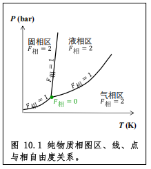{: .center }

$$
P_{\min}=1,\quad \therefore F_{\text{相}}=2+1-1=2
$$

三相：

$$
F_{\text{相}}=2+1-3=0
$$

二相：

$$
F_{\text{相}}=1
$$

---

### 1.3 二元理想混合物的 $P-z_i$ 相图

定温情况下相图为二维：

$$
F_{\text{相max}}=1+C-p_{min}=1+2-1=2
$$

独立变量为 $P,Z_i$:

- 稳定气相

$$
Z_1=τ_1
$$

- 稳定液相

$$
Z_1=\chi_1
$$

$$
Z_1
=\frac{n_{1(a)}+n_{1(b)}}{n_1+n_2}
=\frac{n_{1(a)}+n_{1(b)}}{n_a+n_b}
$$

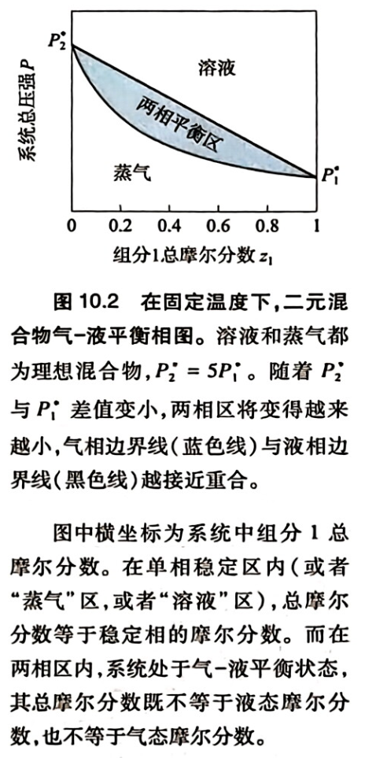{: .center width="280"}

#### 相图边界

拉乌尔定律与道尔顿分压定律：

$$
P_1=\chi_1P_1^*=\tau_1P
$$

**平衡液相边界线**

$$
\begin{aligned}
P&=P_1+P_2\\
&=\chi_1P_1^*+(1-\chi_1)P_2^*\\
&=\boxed{(P_1^*-P_2^*)\chi_1+P_2^*}
\end{aligned}
$$

为一次直线

**平衡气相边界线**

$$
\chi_1=\frac{P-P_2^*}{P_1^*-P_2^*}
$$

由 $\chi_1P_1^*=\tau_1P$：

$$
\begin{aligned}
\tau_1P&=\frac{P_1^*(P-P_2^*)}{P_1^*-P_2^*}\\
\tau_1P(P_1^*-P_2^*)&=P_1^*P-P_1^*P_2^*\\
P\left[P_1^*-\tau_1(P_1^*-P_2^*)\right]&=P_1^*P_2^*
\end{aligned}
$$

$$
\boxed{
P=\frac{P_1^*P_2^*}{P_1^*-(P_1^*-P_2^*)\tau_1}
}
$$

为相图下方下凹曲线

#### 杠杆规则

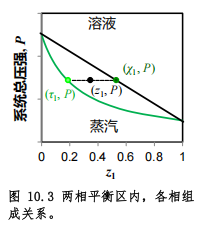{: .center }

图中$Z$ 点代表体系总组成

$$
n=n_{(g)}+n_{(l)}
$$

$$
z_1n=\tau_1n_{(g)}+\chi_1n_{(l)}
$$

联立得：

$$
(z_1-\tau_1)n_{(g)}=(\chi_1-z_1)n_{(l)}
$$

$$
l_{(左)}n_{(左)}=l_{(右)}n_{(右)}
$$

---

### 1.4 二元理想混合物的 $T-z_i$ 相图

混合物沸点没有极值

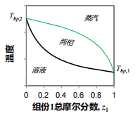{: .center }

混合物沸点有极值（共沸点 $T_{共沸}$）

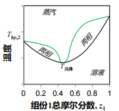{: .center }

!!!EXAMPLE
    乙醇-水共沸

    $$
    w_{\mathrm{C_2H_5OH}}\approx95.6\%
    $$

#### 溶液蒸馏

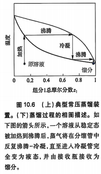{: .center }

---

### 1.5 二元混合物的液-液相图

某个温度区间内，系统两个液态组分不完全互溶，不可能是理想溶液。完全互溶的液体近似理想溶液。

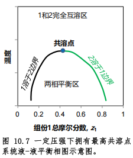{: .center }

少量液体可以溶解为另一组分。摩尔分数相近时出现两相，两组分的含量符合杠杆规则。

---

### 1.6 液-固相图

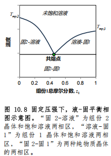{: .center }

- 描述二组分共熔合金：边界为**液相线**
  
- 二元溶液的结晶与溶解平衡：边界为**溶解度**

---

## 第二节 固态溶质的溶解平衡

### 2.1 溶解平衡的标度
 
相：宏观足够小微观足够大（$>10^6$）的均匀体系。

溶解平衡可以用相变方法处理：

$$
\mathrm{NaCl_{(s)}+H_2O_{(l)}
\underset{T,P}{\rightleftharpoons}
Na^+_{(aq)}+Cl^-_{(aq)}}
$$

**固–液**平衡条件：

$$
\mu_{\text{质}}=\mu_{\text{质}}^*
$$

$$
G=(n_{\text{质}}\mu_{\text{质}}+n_{\text{剂}}\mu_{\text{剂}})
+n_{\text{质}}^*\mu_{\text{质}}^*+(n_{\text{剂}}^*\mu_{\text{剂}}^*)
$$

平衡时：

$$
\left(\frac{\partial G}{\partial \xi_{\text{质}}}\right)_{T,P,n_{\text{剂}}}
=\mu_{\text{质}}-\mu_{\text{质}}^*=0
$$

$$
\mu_{\text{剂}}=\mu_{\text{剂}}^*+RT\ln \alpha_{\text{剂}}
$$

---

### 2.2  溶解度定律

给定温度压强下，溶质的标准态/纯态为固态

$$
\mu_{质}^*=\mu_{质}^*+RT\ln\alpha_{质(饱和)}
$$

$$
\alpha_{质(饱和)}=\gamma_{质(饱和)}\chi_{质(饱和)}=1
$$

$$
\chi_{质(饱和)}=\frac{1}{\gamma_{质(饱和)}}<1
$$

**对于固态溶质的饱和溶液活度系数 $>1$**

---

### 2.3 固态溶解于液体溶解平衡的热力学

$$
RT\ln\gamma_i=\Delta_{\text{混(非)}}G_i
$$

这项可正可负。若为负则真实溶解度高于理想值，反之。

$$
\gamma_i=e^{\frac{\Delta_{\text{混(非)}}G_i}{RT}}
$$

$$
\chi_{质(饱和)}=e^{\frac{-\Delta_{\text{混(非)}}G_i}{RT}}
$$

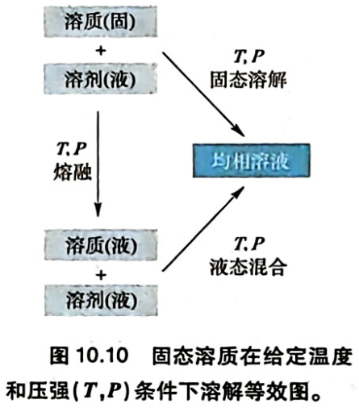{: .center width="280"}

固态溶质的溶解过程等价于定温定压先熔融（假想），再将等温等压液态混合

$$
\chi_{质(饱和)}=e^{\frac{-\Delta_{\text{熔}}G_i}{RT}}·e^{\frac{-\Delta_{\text{液混(非)}}G_i}{RT}}
$$

---

### 2.4 $\Delta_{\text{液混(非)}}G_i<<\Delta_{\text{熔}}G_i$ 的溶解度

$$
\mathrm{HSt_{(s)}\xrightarrow{\text{熔化}}HSt_{(l)}}
$$

$$
\Delta_{\text{液混}}H_m \to 0
$$

$$
\Delta_{\text{熔化}}H_m\approx61\ \mathrm{kJ\cdot mol^{-1}}
$$

$$
\Delta_{\text{液混（非）}}S_m \to 0
$$

$$
\Delta_{\text{熔化}}S_m\approx180\ \mathrm{J\cdot K^{-1}\cdot mol^{-1}}
$$

大量**构象熵释放**

$$
\chi_{质(饱和)}=e^{\frac{-\Delta_{\text{熔}}G_i}{RT}}
$$

其中$\Delta_{\text{熔}}G_i$ 为在给定的$T,P$下的值。

如果温度为熔点，熔融相平衡$\Delta_{\text{熔}}G_i=0$，$\chi_{质(饱和)}$=1，即是相图固液共存边界到达纯溶质端点。

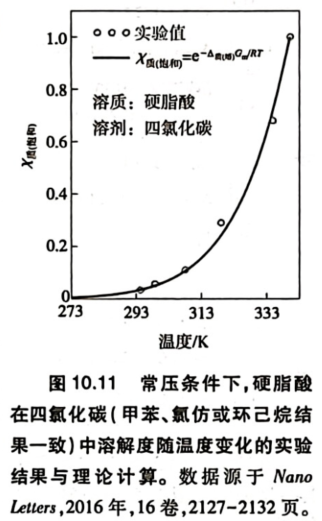{: .center width="260"}

硬脂酸在四氯化碳中可以近似看作理想混合，在水中表现出强烈的非理想性，由于各种分子间作用力约束使得状态数减少，非理想混合熵小于0.

---

### 2.5 “溶质组装型”纳米簇溶液

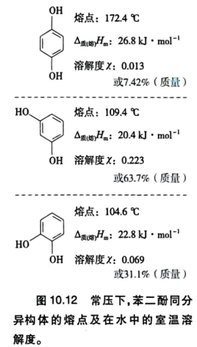{: .center width="270"}

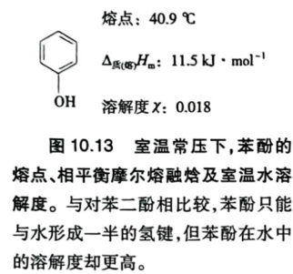{: .center width="270"}

四者都有疏水的超高频区域和亲水的低频区域，熔融溶质与溶剂分子匹配部分朝向溶剂，不匹配部分包裹在内部。三者溶解度差异是非理想混合焓与非理想混合熵共同作用的结果。

---

### 2.6 “溶剂组装型”纳米簇溶液

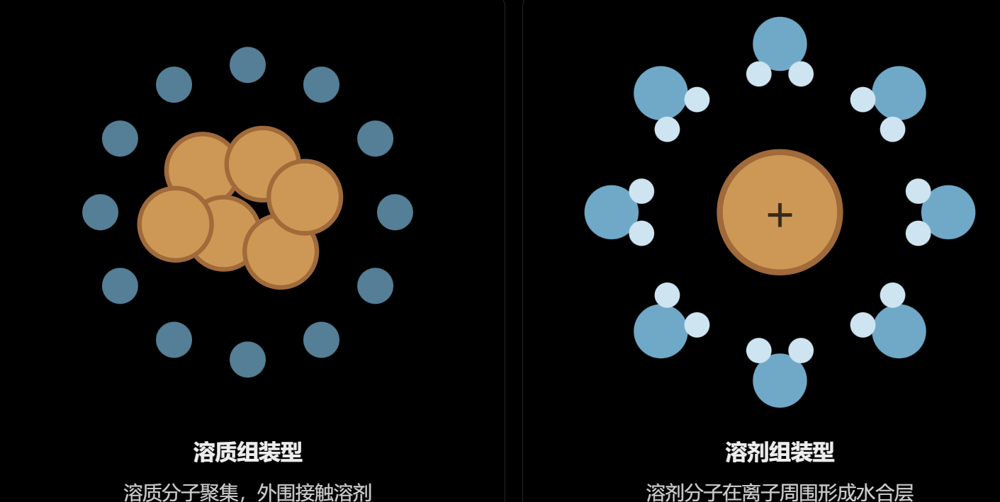{: .center width="300"}

水合相互作用为液态混合提供了有利的热力学贡献。有利的焓贡献可能补偿熵减。

---

## 第三节 流体溶质的溶解平衡

### 3.1 气体溶质溶解可逆热力学

$$
G=G_{(\text{纯态})}+\Delta_{\text{溶}}G
$$

$T、P$ 一定，平衡条件：

$$
\left(\frac{\partial G}{\partial \xi_{\text{溶}}}\right)_{T,P,n_{\text{剂}}}
=\mu_{\text{质(g)}}-\mu_{\text{质(溶液)}}=0
$$

$$
\mu_{\text{质(g)}}^\circ+RT\ln P_{\text{质}}
=\mu_{\text{质}}^*+RT\ln \alpha_{\text{质}}
$$

$$
\mu_{\text{质}}^*
=\mu_{\text{质(g)}}^\circ+RT\ln P_{\text{质}}^*
$$

$$
\ln\frac{P_{\text{质}}}{P_{\text{质}}^*}
=\ln\left(\gamma_{\text{质(饱和)}}\chi_{\text{质(饱和)}}\right)
$$

$$
\boxed{
\gamma_{\text{质(饱和)}}
=\frac{P_{\text{质}}}
{P_{\text{质}}^*\chi_{\text{质(饱和)}}}
}
$$

**构建平衡状态可逆路径**：

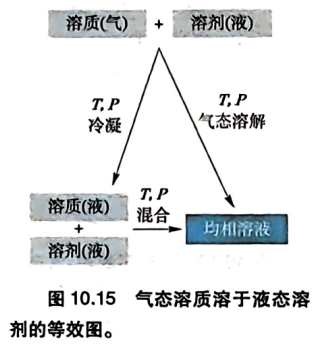{: .center width="300"}

$$
\Delta_{\text{混(非)}}G_{\text{质}}
+\Delta_{\text{混(理)}}G_{\text{质}}=0
$$

$$
\chi_{\text{质(饱和)}}
=e^{-\frac{\Delta_{\text{混(非)}}G_{\text{质}}}{RT}}
$$

$$
\chi_{\text{质(溶液)}}
=
e^{-\frac{\Delta_{\text{凝(纯)}}G_{\text{质}}}{RT}}
e^{-\frac{\Delta_{\text{液混(非)}}G_{\text{质}}}{RT}}
$$

- 普遍地，冷凝熵减极大，气体溶解度一般较小。

- 若$\Delta_{\text{液混(非)}}H_{\text{质}}<<0$，溶解度较大。

- 一般情况，气体$P_\text{质}^*>>P_\text{质}°$，标准溶解度小

---

### 3.2 液体溶质

#### 完全互溶的液体

无溶解度，有相平衡（组分-气相）

$$
\boxed{
\gamma_{\text{质}}
=\frac{P_{\text{质}}}
{P_{\text{质}}^*\chi_{\text{质}}}
}
$$

#### 部分互溶的液体

{: .center }

相平衡区平衡条件：

$$
\mu_{i(A)}=\mu_{i(B)}
$$

$$
\frac{\chi_{i(A)}}{\chi_{i(B)}}
=
\frac{\gamma_{i(B)}}{\gamma_{i(A)}}
$$

**浓度越高，组分活度系数越高**。

---

### 3.3 极难互溶的液-液体系

液-液体系一般无溶解度定律，极难互溶体系有。

考虑水-四氯化碳体系：

溶剂占统治地位，摩尔分数接近1，两相中均有：

$$
\chi_{\mathrm{剂}}\to1
$$

$$
\lim_{\chi_{\mathrm{剂}}\to1}\alpha_{\mathrm{剂}}=1
$$

$$
\lim_{\chi_{\mathrm{剂}}\to1}\gamma_{\mathrm{剂}}=1
$$

$$
\chi_{质(饱和)}=\frac{1}{\gamma_{质(饱和)}}
$$

活度系数越小越容易溶解：相互作用匹配的，纳米簇……

---

## 第五节 活度系数

### 4.1 流体溶质的活度系数

#### 完全互溶&部分互溶的液体

$$
P_{\text{质}}=\alpha_{\text{质}}P_{\text{质}}^*
\quad\Rightarrow\quad
\gamma_{\text{质}}=\frac{P_{\text{质}}}{P_{\text{质}}^*\chi_{\text{质}}}
$$

几项实验均可测

#### 极难溶液体

$$
\chi_{质(饱和)}=\frac{1}{\gamma_{质(饱和)}}
$$

#### 气体溶质

$$
\gamma_{\text{质}}=\frac{P_{\text{质}}}{P_{\text{质}}^*\chi_{\text{质}}}
$$

---

### 4.2 固体溶质的活度系数

#### 饱和溶液

$$
\chi_{质(饱和)}=\frac{1}{\gamma_{质(饱和)}}
$$

有有限溶解度时，活度系数**一定大于1**

#### 非饱和溶液

吉布斯-杜安方程：

$$
\chi_{\text{质}}\,\mathrm{d}(\ln\gamma_{\text{质}})
+\chi_{\text{剂}}\,\mathrm{d}(\ln\gamma_{\text{剂}})=0
$$

积分形式：

$$
\ln\gamma_{\text{质}}
=
\ln\gamma_{\text{质(饱和)}}
-\int_{\ln\gamma_{\text{剂(饱和)}}}^{\ln\gamma_{\text{剂}}}
\frac{\chi_{\text{剂}}}{1-\chi_{\text{剂}}}
\,\mathrm{d}(\ln\gamma_{\text{剂}})
$$

从溶剂的蒸汽压算溶剂的活度系数从而得到溶质活度系数。

!!!NOTE

    恒温恒压下：

    $$
    \chi_{\text{质}}\mathrm d\mu_{\text{质}}
    +\chi_{\text{剂}}\mathrm d\mu_{\text{剂}}=0
    $$

    非理想溶液的化学势：

    $$
    \mu_i=\mu_i^*+RT\ln(\gamma_i\chi_i)
    $$

    $$
    \mathrm d\mu_i
    =RT\mathrm d\ln\gamma_i+RT\mathrm d\ln\chi_i
    $$

    代入得：

    $$
    \chi_{\text{质}}\mathrm d\ln\gamma_{\text{质}}
    +\chi_{\text{剂}}\mathrm d\ln\gamma_{\text{剂}}
    +\mathrm d\chi_{\text{质}}
    +\mathrm d\chi_{\text{剂}}=0
    $$

    由于 $\chi_{\text{质}}+\chi_{\text{剂}}=1$，故：

    $$
    \boxed{
    \chi_{\text{质}}\mathrm d\ln\gamma_{\text{质}}
    +\chi_{\text{剂}}\mathrm d\ln\gamma_{\text{剂}}=0
    }
    $$

---

### 4.3 萃取与多组分体系活度系数

至少一种溶质在液 $\mathrm{A}$ 和 液$\mathrm{B}$ 中达到分配平衡，对于第 $i$ 种溶质：

$$
\mu_{i(A)}=\mu_{i(B)}
$$

$$
\mu_i^*+RT\ln\alpha_{i(A)}
=\mu_i^*+RT\ln\alpha_{i(B)}
$$

$$
\therefore\quad \alpha_{i(A)}=\alpha_{i(B)}
$$

$$
\boxed{
1\ne
\left.\frac{[i]_{(A)}}{[i]_{(B)}}\right|_{\mathrm{平}}
\equiv K_{\text{分配}}
=
\left.\frac{\gamma_{i(B)}}{\gamma_{i(A)}}\right|_{\mathrm{平}}
}
$$

平衡时，溶质在活度系数较小的一相中具有更高的浓度。相同参考态，溶质从化学势高的一相向化学势低的一相转移。

