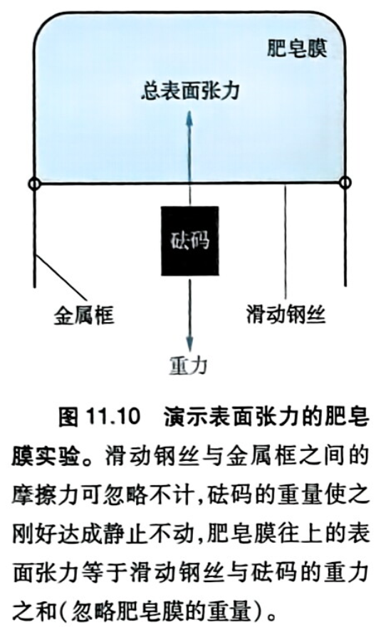
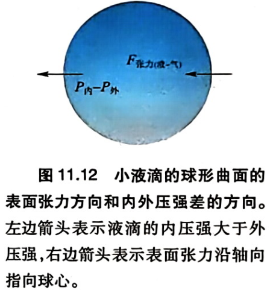
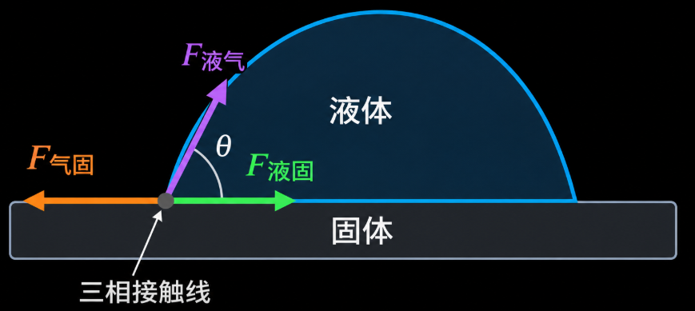
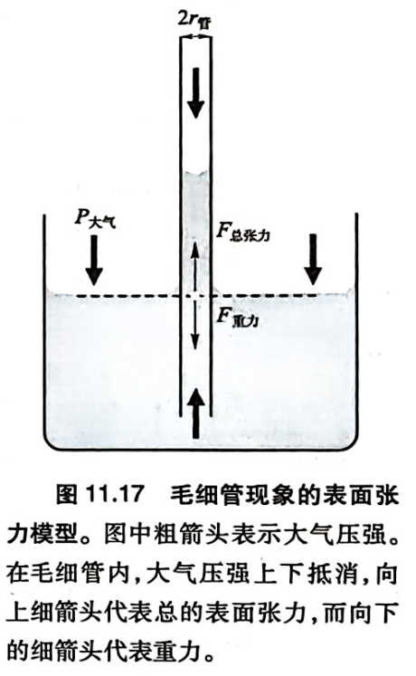
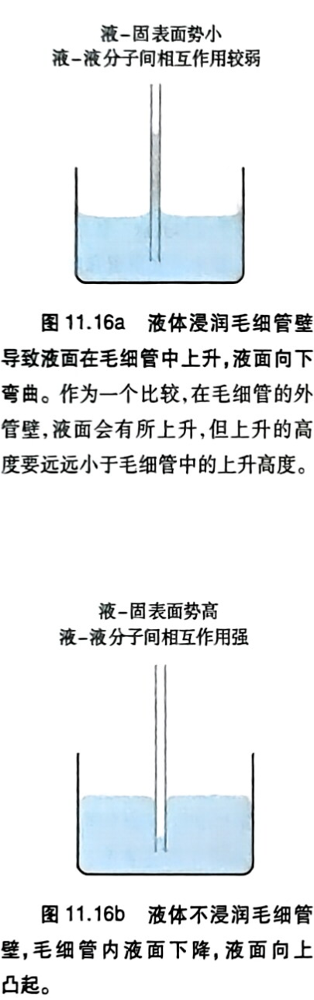
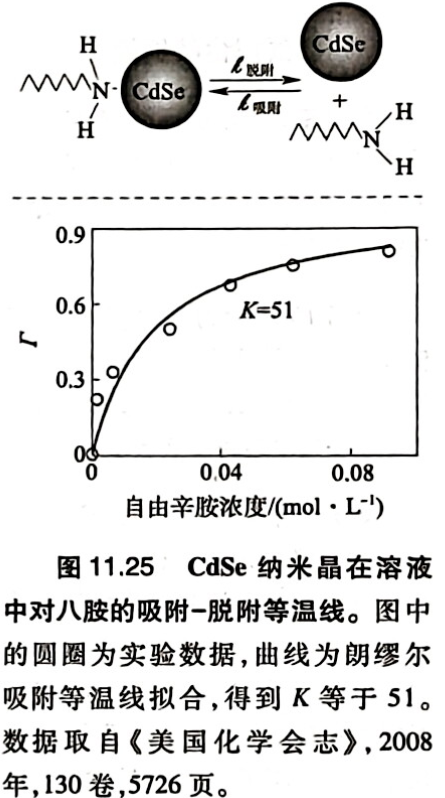
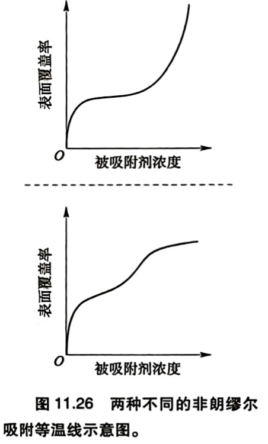

# 第十一章 表面与胶体：表界面

## 第一节 表界面的性质

###　1.1 表界面的特性

表界面（suface/ interface）为两相界面：液-气界面、固-气界面、固-液界面、晶面（固-气）……

表面的热力学性质：

- 表面分子的化学环境不同于体相

- 表面发生重构

- 表面和体相化学势一致达到终点

对于一个平衡态，$T,P$ 给定：

$$
\mathrm{d}G
=-S\mathrm{d}T+V\mathrm{d}P
+\sum_i\mu_{i(\mathrm{\infty})}\mathrm{d}n_i
+\sum_j\sigma_j\mathrm{d}a_j
$$

- $\mu_{i(\infty)}$：完美体相中组分 $i$ 的化学势
- $\sigma_j$：第 $j$ 个表面势
- $a_j$：表面自由度，表面积

$$
\boxed{
\sigma_j
\equiv
\left(\frac{\partial G}{\partial a_j}\right)_{T,P,n_i,a_{k\ne j}}
}
$$

一个体系的总吉布斯自由能

$$
G=\sum_i\mu_{i(\infty)}n_i+\sum_j\sigma_j a_j
$$

---

### 1.2 凝聚态-气态表面

#### 固-气

极不容易制备干净表面，极易有吸附

#### 液-气

**a. 高对称性小分子**

表面势$\sigma_j$

$$
\mathrm{Cl_2(15) < Ar < NH_3 < H_2O(71)< Hg(485) \quad \mathrm{mJ·m^{-2}}}
$$

- 高对称性分子，表面势意味着失去的分子间相互作用（带来的能量/熵），大致$\sigma_j\propto E^0_{m,分子/液}\approx T_{bp}$，也与分子摩尔面积有关（暴露在表面的个数）

**b. 直链烷烃**

$$
\mathrm{CH_3(CH_2)_3CH_3}
<
\mathrm{C_6}
<
\mathrm{C_7}
<
\mathrm{C_8}
$$

- 从左到右稍有增加，均在 $20\mathrm{mJ·m^{-2}}$。表面势主要决定于$\mathrm{-CH_3}$，大量甲基指向气相，减小分子间作用损失。增加因为部分暴露$\mathrm{-CH_3CH_2-……}$。如环己烷表面势大于这些直链烷烃。

**c. 伯醇**

| $\mathrm{CH_3OH}$ | $\mathrm{CH_3CH_2OH}$ | $\mathrm{CH_3(CH_2)_3OH}$ | $\mathrm{CH_3(CH_2)_5OH}$ |
|---|---|---|---|
| 22.07 | 21.97 | 24.93 | 25.81 |

- 极性/氢键长链有机分子，表面势能主要决定于$\mathrm{-CH_3}$。

表面活性剂（一端为甲基，另一端强极性如离子或可形成氢键），通过在表面暴露甲基/疏水基团降低表面势

#### 凝聚相-凝聚相

**a. 固-固界面**

- 晶体易崩塌为两个固-气界面。

- 非晶固体高分子添加粘合剂

**b. 固-液界面**: 浸润

**c. 液-液界面**: 出现分子富集和定向组装。如辛醇-水界面。

---

## 第二节 表面张力

### 2.1 肥皂膜实验

{: .center width="280"}

表面张力：单位长度膜产生的径向收缩力

$$
G=2l·F_{\text{张力}}
$$

存在两个气液界面，横杆长度为 $l$

---

### 2.2 拉普拉斯公式

{: .center width="280"}

半径为 $r$ 的球形液滴，表面积与体积：

$$
a=4\pi r^2,\qquad V=\frac43\pi r^3
$$

$$
\mathrm da=8\pi r\,\mathrm dr
$$

$$
\mathrm dV=4\pi r^2\,\mathrm dr
$$

表面张力收缩使液滴受到**向内**的合力，由压强差平衡。平衡时，内外压强差所做的功等于增加表面积所需的功。其中表面张力是单位距离的力，做功如下：

$$
(P_{\text{内}}-P_{\text{外}})\mathrm dV
=F_{\text{张力}}\,\mathrm da
$$

$$
(P_{\text{内}}-P_{\text{外}})4\pi r^2\,\mathrm dr
=F_{\text{张力}}8\pi r\,\mathrm dr
$$

拉普拉斯公式：

$$
P_{\text{内}}-P_{\text{外}}=\frac{2F_{\text{张力}}}{r}
$$

液滴半径越小，内外压强差越大

---

### 2.3 杨方程

{: .center width="290"}

$$
F_{\text{气-固}}-F_{\text{液-固}}
=F_{\text{液-气}}\cos\theta
$$

$\theta>90°$，不浸润，即液体不会降低固体的表面势。

---

## 第三节 吉布斯方案

从热力学角度处理表面问题，而非力

### 3.1 吉布斯表面方程

$T,P$ 给定：

$$
\mathrm{d}G
=-S\mathrm{d}T+V\mathrm{d}P
+\sum_i\mu_{i(\mathrm{\infty})}\mathrm{d}n_i
+\sum_j\sigma_j\mathrm{d}a_j
$$

$$
G=\sum_i\mu_{i(\infty)}n_i+\sum_j\sigma_j a_j
$$

---

### 3.2 肥皂膜实验

$T、P$ 恒定

$$
\left(\frac{\partial G}{\partial x}\right)_{T,P,n_i}
=F_{\text{重力}}
$$

$$
G=\sum_i\mu_{i(\infty)}n_i+\sigma(2lx)
$$

$$
\begin{aligned}
F_{\text{重力}}
&=\left(\frac{\partial G}{\partial x}\right)_{T,P,n_i}\\
&=0+2lx\left(\frac{\partial\sigma}{\partial x}\right)_{T,P,n_i}
+2l\sigma
\end{aligned}
$$

若：

$$
\left(\frac{\partial\sigma}{\partial x}\right)_{T,P,n_i}=0
$$

则：

$$
F_{\text{张力}}=\sigma
$$

实际情况：

$$
F_{\text{张力}}=x\left(\frac{\partial\sigma}{\partial x}\right)_{T,P,n_i}
+\sigma
$$

需考虑表面势是否随面积改变

---

### 3.3 小液滴实验

$$
P_{\text{内}}-P_{\text{外}}
=\frac{2\sigma}{r}
+\left(\frac{\partial\sigma}{\partial r}\right)_{T,P,n}
$$

需考虑表面势是否随半径改变

---

### 3.4 毛细管

{: .center width="290"}

$$
h=\frac{2F_{\text{张力（液-气）}}}{r_{\text{管}}\rho_{\text{液}}g}
=\frac{2\sigma_{\text{液-气}}}{r_{\text{管}}\rho_{\text{液}}g}
$$

管径越小，上升高度越高

{: .center width="290"}

不浸润现象如汞，产生液固界面需打破金属键，表面势高。

热力学平衡条件

$$
\left(\frac{\partial G}{\partial h}\right)_{T,P,n}=0
$$

吉布斯自由能可分为：

$$
G=G_{\text{体相}}+G_{\text{表面}}+G_{\text{重力}}
$$

$$
G=\sum_i\mu_{i(\infty)}n_i
-(\sigma_{\text{气-固}}-\sigma_{\text{液-固}})
\int_0^h C_{\text{管}}\,\mathrm{d}h
+\int_0^h \rho gh\,a_{\text{管}}\,\mathrm{d}h
$$

对于非均匀截面的管：

$$
C_{\text{管}}=f(h)
$$

$$
a_{\text{管}}=g(h)
$$

#### 圆管

对于半径为 $r_{\text{管}}$ 的圆管：

$$
C_{\text{管}}=2\pi r_{\text{管}}
$$

$$
a_{\text{管}}=\pi r_{\text{管}}^2
$$

平衡时：

$$
\left(\frac{\partial G}{\partial h}\right)_{T,P,n}=0
$$

$$
0=-(\sigma_{\text{气-固}}-\sigma_{\text{液-固}})2\pi r_{\text{管}}
+\rho gh\pi r_{\text{管}}^2
$$

$$
\boxed{
h=\frac{2(\sigma_{\text{气-固}}-\sigma_{\text{液-固}})}
{\rho g r_{\text{管}}}
}
$$

考虑三相界面：

$$
\sigma_{\text{气-固}}-\sigma_{\text{液-固}}
=\sigma_{\text{液-气}}\cos\theta
$$

得到同样的结果。

#### 方管

对于边长为 $L_{\text{管}}$ 的方管：

$$
C_{\text{管}}=4L_{\text{管}}
$$

$$
a_{\text{管}}=L_{\text{管}}^2
$$

平衡时：

$$
\left(\frac{\partial G}{\partial h}\right)_{T,P,n}=0
$$

$$
0=-(\sigma_{\text{气-固}}-\sigma_{\text{液-固}})4L_{\text{管}}
+\rho ghL_{\text{管}}^2
$$

$$
\boxed{
h=\frac{4(\sigma_{\text{气-固}}-\sigma_{\text{液-固}})}
{\rho gL_{\text{管}}}
}
$$

从能量出发的吉布斯方案免去了复杂的受力分析

---

## 第四节 表面吸附

### 4.1 固体表面的等价位点吸附

$$
\mathrm{Site}+i_{(\text{自由})}
\underset{k_{\text{脱附}}}{\overset{k_{\text{吸附}}}{\rightleftharpoons}}
(\mathrm{Site}-i)_{\text{吸附}}
$$

动态平衡：

$$
v_{\text{吸附}}=v_{\text{脱附}}
$$

$$
v_{\text{吸附}}=k_{\text{吸附}}N_{\text{自由}}C
$$

$C$为自由被吸附物浓度

$$
v_{\text{脱附}}=k_{\text{脱附}}N_{\text{吸附}}
$$

$$
N_0=N_{\text{自由}}+N_{\text{吸附}}
$$

定义平衡常数和表面覆盖度：

$$
\frac{k_{\text{吸附}}}{k_{\text{脱附}}}
=K
=\frac{N_{\text{吸附}}}{N_{\text{自由}}C}
=\frac{\Gamma}{C(1-\Gamma)}
$$

$$
\Gamma=\frac{N_{\text{吸附}}}{N_0}
$$

$$
\frac{\Gamma}{1-\Gamma}=KC
$$

**朗缪尔吸附等温式**：

$$
\boxed{\Gamma=\frac{KC}{1+KC}}
$$

$$
C\rightarrow\infty,\qquad \Gamma\rightarrow 1
$$

{: .center width="290"}

**Langmuir 吸附模型的基本假设**

1. 固体表面吸附位点数量固定

2. 每个位点最多吸附一个分子，形成**单分子层**吸附。

3. 所有吸附位点等价，具有相同的吸附能力。

4. 吸附分子之间不存在相互作用。

5. 吸附和脱附过程均为基元步骤：
   - 吸附速率与气体浓度 $C$ 和自由位点数 $N_{\text{自由}}$ 成正比。

   - 脱附速率仅与已占据位点数 $N_{\text{吸附}}$ 成正比。

6. 吸附和脱附在**恒定温度**下进行，速率常数 $k_{\text{吸附}}$ 和 $k_{\text{脱附}}$ 保持不变。

---

### 4.2 复杂吸附

{: .center width="290"}

#### 多层吸附

前段符合单层吸附特征

#### 非等价位点

强吸附先发生

#### BET模型

开放表面+孔吸附……

---

# 第十二章 胶体溶液

## 第一节 胶体及其物理性质

### 1.1 胶体

定义：纳米尺寸粒子相对稳定分散在介质中，结构成分相对固定