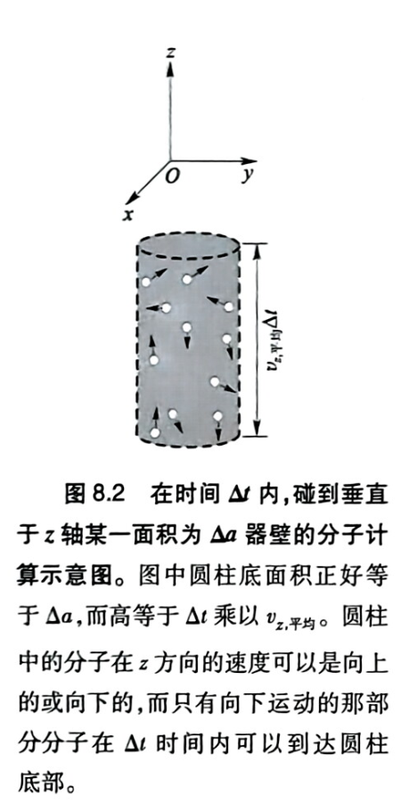
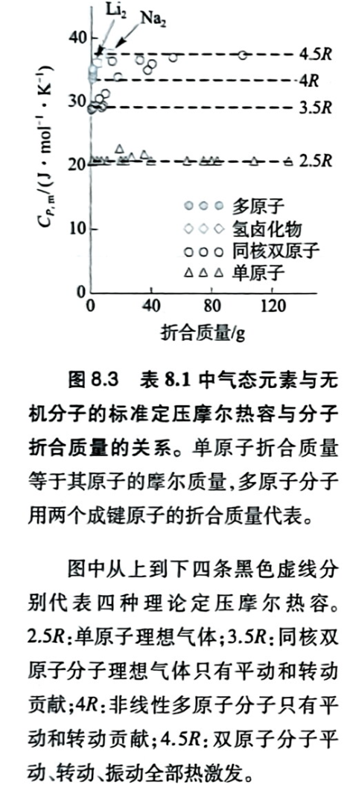
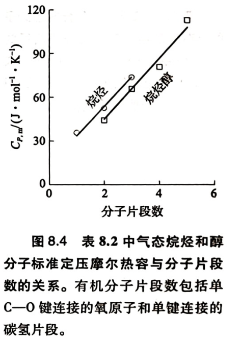
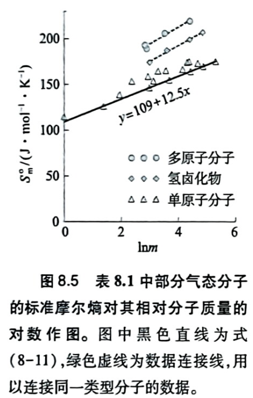
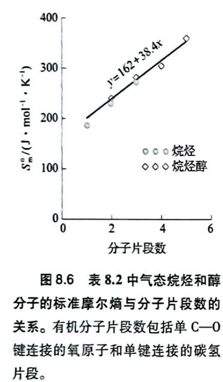
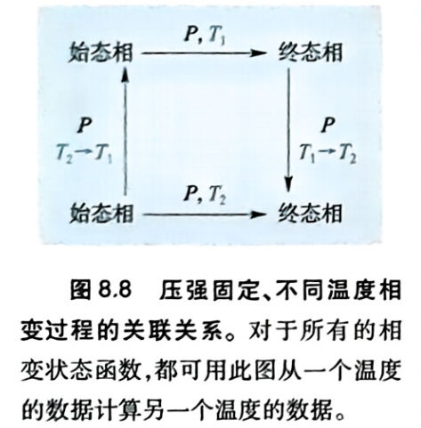
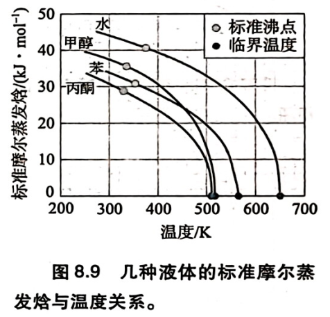
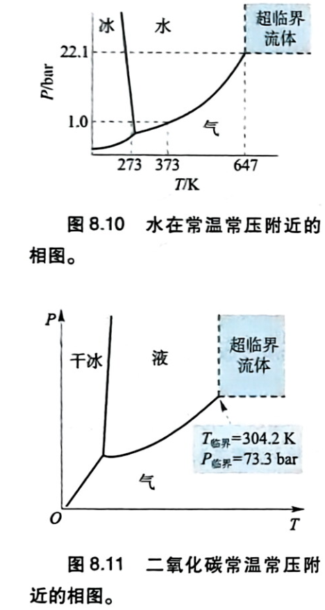

# 第8章 纯物质的体相性质

## 第一节 经典气体理论

### 1.1 定性模型

- $r_{分子}<<d_{分子}$

- 无分子间相互作用，弹性碰撞

- 气体分子处于无休止运动

---

### 1.2 定量模型

{: .center width="280"}

根据牛顿定律：

$$
F=\frac{\Delta(m\vec{v})}{\Delta t}
$$

单个分子碰撞器壁产生的压强：

$$
P_1=\frac{F_x}{a}=\frac{2m\overline{v}_x}{\Delta t\cdot a}
$$

在 $\Delta t$ 时间内，撞击面积 $a$ 的分子数为：

$$
N_{\text{撞}}=\frac{1}{2}\big(\overline{v}_x\Delta t\cdot a\big)\cdot \frac{nN_{\text{A}}}{V}
$$

总压强等于单个分子压强乘以撞击分子数：

$$
\therefore P = P_1 \cdot N_{\text{撞}}
$$

$$
P=\frac{N_{\text{A}}m\overline{v}_x^2}{V}\cdot n
$$

$$
\therefore PV = n\cdot \big(N_{\text{A}}m\overline{v}_x^2\big)=n\cdot 2E_{\text{k(平)}}
$$

与理想气体状态方程对比

$$
E_{\text{k(平)}}=\frac{1}{2} RT = E_{\text{k(1)}} = E_{\text{k(总)}}
$$

**能量均分定理**：每一个能量二阶项热能贡献为 $\frac{1}{2}RT$

---

## 第二节 气体的量子统计热力学

### 2.1 理想气体状态方程

!!!NOTE
    $$dU=TdS-PdV$$

    $$dA=-SdT-PdV$$

$$
P=-\left(\frac{\partial A}{\partial V}\right)_{T,n}
=nRT\left[\frac{\partial(\ln f_{\text{总}})}{\partial V}\right]_{T,n}
=nRT\left[\frac{\partial(\ln f_{\text{平动}})}{\partial V}\right]_{T,n}
=nRT\left[\frac{\partial(\ln V)}{\partial V}\right]_{T,n}
=\frac{nRT}{V}
$$

!!!NOTE
    $$U = U(0) + Q$$

    $$A = U - TS = U(0) + Q - TS$$

    热运动内能：

    $$Q = NkT^2 \left(\frac{\partial \ln f_{\text{总}}}{\partial T}\right)_V$$
    
    熵：

    $$S = Nk \ln f_{\text{总}} + \frac{Q}{T}$$

    $$
    \begin{aligned}
    A &= U(0) + Q - T\left(Nk \ln f_{\text{总}} + \frac{Q}{T}\right) \\
    &= U(0) + Q - NkT \ln f_{\text{总}} - Q \\
    &= U(0) - NkT \ln f_{\text{总}}
    \end{aligned}
    $$
    
    $$\boxed{A = U(0) - nRT \ln f_{\text{总}}}$$

只要气体行为满足量子力学则必然得到理想气体状态方程。

---

### 2.2 定压摩尔热容

$$C_{m,p} = C_{m,V} + R = \frac{5 + F_{\text{转}}}{2}R + \sum_j f_j(u, k_{键})$$

$u$ 为折合质量

振动频率：

$$\tilde{\nu} = 1302\sqrt{\frac{k}{u}} \quad (\mathrm{cm^{-1}})$$

{: .center width="290"}

- 单原子分子：$C_{m,p} = \frac{5}{2}R$

- 双原子分子：$C_{m,p} = 3.5R + f(u, k)$

    - 含氢分子：$u \approx 0$,$f \approx 0$

    - 其它双原子分子：$f$ 随 $u$ 增而增，例如 $\mathrm{N_2}$、$\mathrm{O_2}$、$\mathrm{I_2}$（分子量越大，振动越易激发，$f$ 越大）

    - 活泼$ⅠA$族金属双原子分子金属键结合，$k_{键}$很小，更快接近**低频高温近似**值。

- 多原子分子：$\mathrm{H_2O}$、$\mathrm{H_2S}$、$\mathrm{H_2Se}$、$\mathrm{NH_3}$，均在$4R$附近。

- 有机多原子分子
  
    - 碳氢伸缩振动可忽略

    - 构象振动与变形振动不可忽略。如放热反应找溶剂可以找直链。

    - 氢被取代：杂原子取代化合物气态标准定压摩尔热容明显高于取代前的碳氢分子。

{: .center width="300"}

两个线性关系的斜率相等，在 $20\ \mathrm{J \cdot mol^{-1} \cdot K^{-1}}$ 。该值说明每个单键片段贡献 $2.5R$ 。

---

### 2.3 理想气体标准态摩尔熵

标准态：$1bar，300K $

不同理想气体之间摩尔体积相同，不同的只有摩尔质量。重分子平动能级密，可及量子态多。

标准摩尔**平动**熵：

$$
S_{m(气)}^\circ=109+\frac{3R}{2}\ln M \mathrm{J\cdot mol^{-1}\cdot K^{-1}}
$$

{: .center width="280"}

- 单原子实际高出一些，因为存在电子熵（电子层未满即有简并度）

- 双原子氢卤化物：比直线高约 $33\ \mathrm{J\cdot mol^{-1}\cdot K^{-1}}$，基本由转动贡献
  
- 无机多原子分子：比直线高约 $45\ \mathrm{J\cdot mol^{-1}\cdot K^{-1}}$

{: .center width="280"}

- 有机多原子分子：柔性分子**每个片段构象振动**对应4~5个小分子转动自由度

- 杂原子取代：三类标准摩尔熵**均增加**（平动、转动、振动能隙都明显减小）

---

### 2.4 气体的化学势

纯态：$\mu = G_m= U_m + (PV)_m - T S_m=U_m - T S_m + RT$

理想气体：

$$
\mu=\mu^\circ+RT\ln P
$$

!!!NOTE
    $$
    \mathrm{d}\mu = \mathrm{d}G_m = V_m \mathrm{d}P
    $$

    理想气体 $V_m = \dfrac{RT}{P}$，积分：

    $$
    \int_{\mu^\circ}^{\mu} \mathrm{d}\mu = \int_{P^\circ}^{P} \frac{RT}{P}\,\mathrm{d}P
    $$

    $$
    \mu - \mu^\circ = RT \ln\frac{P}{P^\circ}
    $$

    $$
    \boxed{\mu = \mu^\circ + RT\ln\frac{P}{P^\circ}}
    $$

实际气体（气体逸度 $\alpha$；逸度系数 $\gamma$）：

$$
\mu=\mu^\circ+RT\ln\alpha
$$

$$
\alpha=\gamma P
$$

--- 

## 第三节 纯物质相变热力学

### 3.1 相平衡

**定温定压封闭系统**相平衡条件：

$$
\left(\frac{\partial G}{\partial\xi}\right)_{T,P}=0
$$

定义（摩尔）相变吉布斯自由能

$$\Delta_{\text{tr}}G \equiv \left(\frac{\partial G}{\partial \xi}\right)_{T,P}$$

-  与摩尔数无关
-  是一个状态函数
-  $\Delta G \neq \Delta_{\text{trs}}G$（绝大多数情况下成立）

$$G = n_1 G_{m,1} + n_2 G_{m,2}$$

$$\mathrm{d}\xi = \mathrm{d}n_2 = -\mathrm{d}n_1$$

$$\mathrm{d}G = -S\mathrm{d}T + V\mathrm{d}P$$

$$
\therefore \left(\frac{\partial G}{\partial \xi}\right)_{T,P}
=\left(\frac{\partial(n_1 G_{m,1}+n_2 G_{m,2})}{\partial \xi}\right)_{T,P}
=G_{m,2}-G_{m,1}=\mu_2-\mu_1
$$

平衡时：

$$\Delta_{\text{tr}}G_\text{平衡}=\mu_2-\mu_1=0$$

$$\therefore \mu_2=\mu_1$$

摩尔相变焓、摩尔相变熵均为**状态函数**，强度性质，三者符合如下（$G=H-TS$同时偏导）：

$$\Delta_\text{tr}G =0= \Delta_\text{tr}H - T_\text{tr}\Delta_\text{tr}S$$

平衡时取得：

$$
\Delta_{tr}S_{m}=\frac{\Delta_{tr}H_{m}}{T_{tr}}=-S_{m,分子/液}
$$

---

### 3.2 相变数据计算

{: .center width="280"}

$$\int_{T_2}^{T_1} C_{p,m}(\text{始}) \, dT + \Delta_{\mathrm{tr}} H_m(T_1) + \int_{T_1}^{T_2} C_{p,m}(\text{终}) \, dT - \Delta_{\mathrm{tr}} H_m(T_2) = 0$$

$$
\Delta_{tr}H_m(T_2)=\Delta_{tr}H_m(T_1)+\int_{T_1}^{T_2}\Delta C_{P,m}\,dT
\approx\Delta_{tr}H_m(T_1)+\Delta C_{P,m}\cdot\Delta T
$$

!!!NOTE
    $$\Delta_{\mathrm{tr}} H_m(T) = H_{m,\beta}(T) - H_{m,\alpha}(T)$$

    $$\frac{d\,\Delta_{\mathrm{tr}} H_m}{dT} = \frac{dH_{m,\beta}}{dT} - \frac{dH_{m,\alpha}}{dT}$$

    $$\frac{d\,\Delta_{\mathrm{tr}} H_m}{dT} = C_{p,m}(\beta) - C_{p,m}(\alpha) = \Delta C_{p,m}$$

    $\Delta C_{p,m}$为两相定压摩尔热容差。

!!!NOTE
    状态函数法使得某个不可测的相变过程（可以是假想的）变得可以计算。

同理：

$$
\Delta_{tr}S_m(T_2)=\Delta_{tr}S_m(T_1)+\int_{T_1}^{T_2}\frac{\Delta C_{P,m}}{T}\,dT
\approx\Delta_{tr}S_m(T_1)+\Delta C_{P,m}\cdot\ln\frac{T_1}{T_2}
$$

!!!NOTE
    定压熵变：

    $$
    \Delta S=\int_{T_1}^{T_2}\frac{dH}{T}\,
    $$

对于蒸发（远离临界点的温度区间），如果$T_1 - T_2$ 改变不太大， $\Delta C_{P,m}$为常数，上面两式中可以提出。

{: .center width="280"}

---

### 3.3 纯物质相图

任意相：

$$\mu=f(P,T)$$

{: .center width="280"}

- 单相区

- 两相平衡线：$\mu _1=\mu_2$

- 三相点：$\mu _1=\mu_2=\mu_3$

- 临界与超临界（非相变、非热力学性质，流体性质），无黏度，完整均匀充盈整个容器

---

### 3.4 相区的相对位置

**气态总是在凝聚态下方**

**证明**：

$$
\Delta_{\text{tr}} G = \mu_{\text{凝聚}} - \mu_{\text{气}}
$$

平衡点 $p = p^*$：

$$
\Delta_{\text{tr}} G = 0
$$

!!!NOTE
    $$dG=-SdT+VdP$$

$$
\left(\frac{\partial \Delta_{\text{tr}} G}{\partial p}\right)_T = V_{m,\text{凝聚}} - V_{m,\text{气}}
$$

$$
\because V_{m,\text{气}} \gg V_{m,\text{凝聚}} \quad \therefore \left(\frac{\partial \Delta_{\text{tr}} G}{\partial p}\right)_T < 0
$$

- $p > p^*$， $\Delta_{\text{tr}} G< 0$ ，凝聚态 

- $p = p^*$， $\Delta_{\text{tr}} G= 0$ ，相平衡

- $p < p^*$， $\Delta_{\text{tr}} G> 0$ ，气态

**固态总是在液态的左方**

考虑等压融化过程

$$
\left(\frac{\partial \Delta_{\text{tr}} G}{\partial T}\right)_p = S_{m,\text{液}} - S_{m,\text{凝聚}} > 0
$$

---

$$
\left(\frac{\partial\mu}{\partial T}\right)_{P,n}
=\left(\frac{\partial G_m}{\partial T}\right)_{P,n}
=-S_m
$$

由相平衡 $\mu_1=\mu_2$，可得两相边界斜率（克拉伯龙方程）：

$$
\frac{dP}{dT}=\frac{\Delta_{tr}S_{m(平衡)}}{\Delta_{tr}V_{m(平衡)}}
=\frac{\Delta_{tr}H_{m(平衡)}}{T_{平衡}\Delta_{tr}V_{m(平衡)}}
$$

对气-液相变，可变化为（$P^*$：饱和蒸气压）：

$$
\frac{dP^*}{dT}=\frac{\Delta_{tr}H_{m(平衡)}}{T_{平衡}\Delta_{tr}V_{m(平衡)}}
=\frac{P^*\Delta_{tr}H_{m(平衡)}}{R(T_{平衡})^2}
$$

### 3.3 沸点、熔点与临界点

#### 3.3.1 标准沸点与分子结构

由相变过程中 $\Delta_{tr}G_{m(平衡)}=0$，得

$$
T_{bp}=\frac{\Delta_{tr}H_{m(bp)}}{\Delta_{tr}S_{m(bp)}}
=\frac{E_{m,分子/液}}{R-\Delta_{tr}S_{m(bp)}}
=\frac{E^0_{m,分子/液}}{-\frac{1+F_{转}}{2}R-\Delta_{tr}S_{m(bp)}}
$$

**非氢键多原子分子**（$\Delta_{tr}S^\circ_{m(bp)}=84.4\ \mathrm{J\cdot mol^{-1}\cdot K^{-1}}$）：

$$
T_{bp}(K)=-10.0E^0_{m,分子/液}(\mathrm{kJ\cdot mol^{-1}})
$$

**氢键分子**的 $\Delta_{tr}S^\circ_{m(bp)}$ 会明显大于 $84.4\ \mathrm{J\cdot mol^{-1}\cdot K^{-1}}$

#### 3.3.2 标准熔点与分子结构

标准熔点：

$$
T_{mp}=\frac{\Delta_{tr}H_{m(mp)}}{\Delta_{tr}S_{m(mp)}}
=\frac{E_{m,分子/液}-E_{m,分子/固}}
{\Delta_{tr}S_{(类振动)}+\Delta_{tr}S_{(定向)}+\Delta_{tr}S_{(分子内振动)}}
$$

- $\Delta_{tr}S_{(类振动)}$：两种类振动自由度的摩尔熵在液态与晶态的差别
- $\Delta_{tr}S_{(定向)}$：从晶态变成液态所造成的分子摩尔空间取向熵改变
- $\Delta_{tr}S_{(分子内振动)}$：熔融过程中发生明显运动模式改变的分子内振动自由度的摩尔变化
- 接近球形的四面体分子：

    $$
    T_{mp}\approx-100\times(E_{m,分子/液}-E_{m,分子/固})(K)
    $$

- 随着碳原子数增加：
    - 蒸发过程的标准摩尔蒸发熵改变不大，满足特鲁顿规则
    - 熔融过程大量激发分子内旋转等构象熵，其熔融熵随碳原子数增加快速增加
- 随碳原子数增加，正烷烃的标准熔点增加速率应该大大慢于标准沸点的增加速率。但图8.17揭示，标准熔点增加速率只是稍慢于标准沸点的增加速率。
- 熔融过程在释放大量的构象熵的同时，通过热布居分子内构象振动自由度而大大增加了液态的热能，两个效应部分相抵消

## 4 纯物质的凝聚态

### 4.1 凝聚态纯物质的化学势

液态：（$\mu^*$：**纯液态化学势=饱和蒸气化学势**；$P^*$：饱和蒸气压）

$$
\mu_{液}=\mu^*=\mu^\circ+RT\ln P^*
$$

固态：

$$
\mu_{固}=\mu^\circ+RT\ln P^*
$$

### 4.2 液态的量子统计热力学性质

#### 4.2.1 液态定压热容与自由度转化

分子内振动不活跃的**液态热容原理**：

$$
C_{P,m(液)}=1.9(C_{P,m(气)}-R)
$$

#### 4.2.2 液态标准定压热容与分子间相互作用基态能

由：

$$
Q_{m(液)}=Q_{m(气)}+\frac{3+F_{转}}{2}RT
$$

得：

$$
C_{V,m(液)}=C_{V,m(气)}+\frac{3+F_{转}}{2}R
$$

且由：

$$
C_{P,m(液)}=C_{V,m(液)}+\frac{V_mT(\alpha_P)^2}{\pi_T}
$$

热膨胀系数 $\alpha_P\equiv\frac{1}{V_m}\left(\frac{\partial V_m}{\partial T}\right)_P$，定温压缩系数 $\pi_T\equiv-\frac{1}{V_m}\left(\frac{\partial V_m}{\partial P}\right)_T$

非氢键分子的**液态热容原理**：

$$
C_{P,m(液)}=C_{V,m(气)}+\frac{3+F_{转}}{2}R+\frac{V_mT(\alpha_P)^2}{\pi_T}
$$

氢键分子：

$$
C_{P,m(液)}=C_{V,m(气)}+C_{V,m(氢键)}+\frac{3+F_{转}}{2}R+\frac{V_mT(\alpha_P)^2}{\pi_T}
$$

#### 4.2.3 液态单位体积比热

体积比热：单位体积定压热容

$$
\nu=\frac{C_P}{V}=\frac{C_{P,m}}{V_m}
$$

对化学过程影响最大的是体积比热，液态介质是化学反应非常强有力的推动剂（反应空间无法散热）

#### 4.2.4 液态熵补偿

液态介质能够有效地捕获反应产生的热量

#### 4.2.6 液态体积

- 凝聚态体积：分子间相互作用
- 气态体积：系统分子的集体行为：系统的多样性或熵
    - 气体体积反映的不是物质本身的相互作用性质，取决于环境提供的**边界条件**（容器大小）

### 4.3 固态的量子统计热力学性质简论

#### 4.3.1 固态分子图像

- 含N个原子的晶体：
    - 3个平动自由度
    - 3个转动自由度
    - **振动自由度无限接近3N。**
- 讨论晶体性质，晶体的振动自由度一般就当作 3N，而完全忽略平动和转动自由度

#### 4.3.2 固态定压热容

固体中核运动的量子自由度全部是**振动自由度**

$$
C_{P,m(固)}=\left(\frac{\partial U_{m(固)}}{\partial T}\right)_P(+PV_m\alpha_P)
=\sum_{j=1}^{3A}\frac{k(j/kT)^2}{(e^{j/2kT}-e^{-j/2kT})^2}
+\left(\frac{\partial E^0_{m,分子/固}}{\partial T}\right)_P
$$

- 第一项：分子在所有**振动自由度摩尔热容**的总值（极限值为 $3R$）
- 第二项：分子间相互作用基态能对温度的依赖性，反映固体中分子间距随温度的变化（$>0$）

$$
\left(\frac{\partial E^0_{m,分子/固}}{\partial T}\right)_P
=-\frac{1}{3}\alpha_PE^0_{m,分子/固}
$$

**(A) 单原子或单原子离子构成的固体**

只有分子集体振动自由度

**(B) 含局域共价键的分子晶体**

除平动转化的集体振动外，还应加上转动转化

#### 4.3.3 固态熵

$$
S_{m(固)}(T)=\int_0^T\frac{C_{P,m(固)}}{T}\,dT
=\int_0^T\frac{C_{V,m(固)}}{T}\,dT
+\int_0^T\frac{(\partial E^0_{m,分子/固}/\partial T)_P}{T}\,dT
$$

- 第一项：固态每个**振动自由度的摩尔熵**
- 第二项：分子间电磁相互作用带来的摩尔熵
