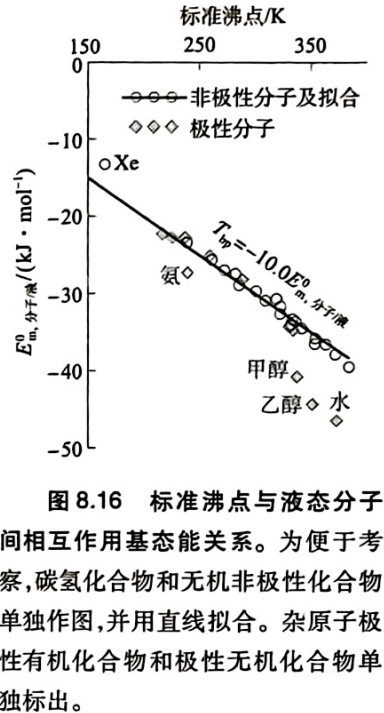
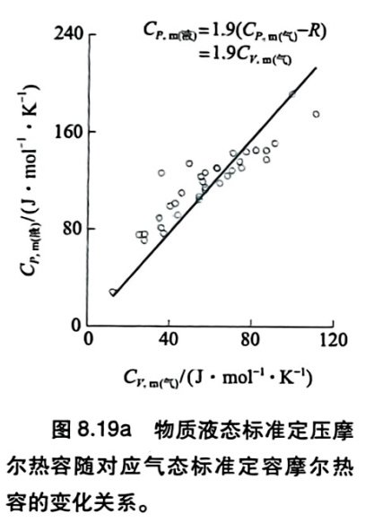
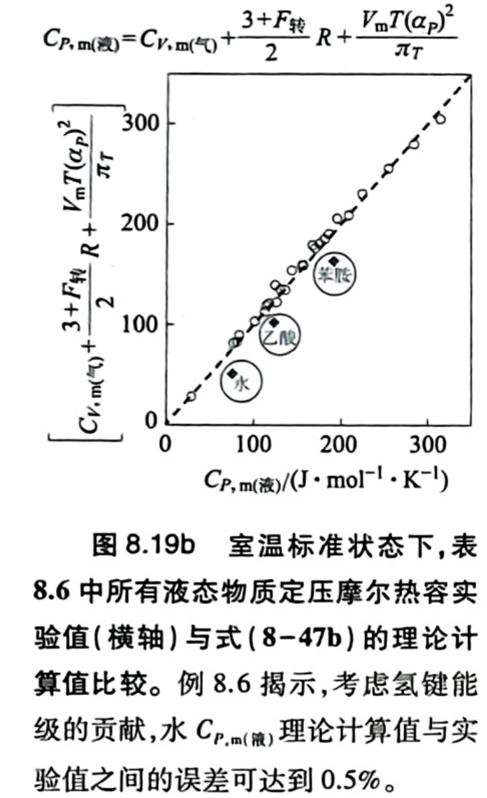
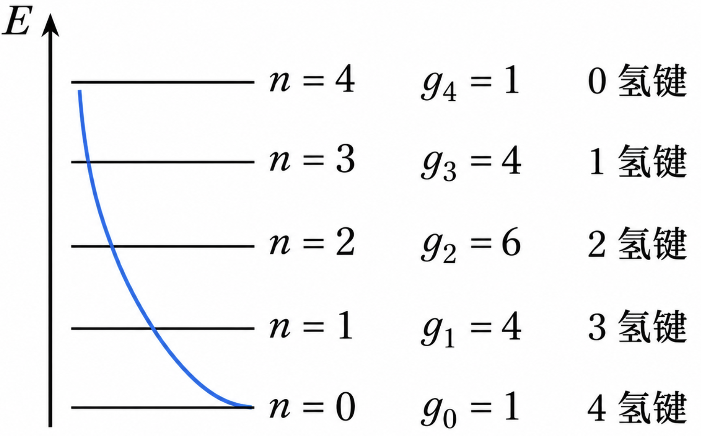

# 第8章 纯物质的体相性质

## 第一节 经典气体理论

### 1.1 定性模型

- $r_{分子}<<d_{分子}$

- 无分子间相互作用，弹性碰撞

- 气体分子处于无休止运动

---

### 1.2 定量模型

{: .center width="280"}

根据牛顿定律：

$$
F=\frac{\Delta(m\vec{v})}{\Delta t}
$$

单个分子碰撞器壁产生的压强：

$$
P_1=\frac{F_x}{a}=\frac{2m\overline{v}_x}{\Delta t\cdot a}
$$

在 $\Delta t$ 时间内，撞击面积 $a$ 的分子数为：

$$
N_{\text{撞}}=\frac{1}{2}\big(\overline{v}_x\Delta t\cdot a\big)\cdot \frac{nN_{\text{A}}}{V}
$$

总压强等于单个分子压强乘以撞击分子数：

$$
\therefore P = P_1 \cdot N_{\text{撞}}
$$

$$
P=\frac{N_{\text{A}}m\overline{v}_x^2}{V}\cdot n
$$

$$
\therefore PV = n\cdot \big(N_{\text{A}}m\overline{v}_x^2\big)=n\cdot 2E_{\text{k(平)}}
$$

与理想气体状态方程对比

$$
E_{\text{k(平)}}=\frac{1}{2} RT = E_{\text{k(1)}} = E_{\text{k(总)}}
$$

**能量均分定理**：每一个能量二阶项热能贡献为 $\frac{1}{2}RT$

---

## 第二节 气体的量子统计热力学

### 2.1 理想气体状态方程

!!!NOTE
    $$dU=TdS-PdV$$

    $$dA=-SdT-PdV$$

$$
P=-\left(\frac{\partial A}{\partial V}\right)_{T,n}
=nRT\left[\frac{\partial(\ln f_{\text{总}})}{\partial V}\right]_{T,n}
=nRT\left[\frac{\partial(\ln f_{\text{平动}})}{\partial V}\right]_{T,n}
=nRT\left[\frac{\partial(\ln V)}{\partial V}\right]_{T,n}
=\frac{nRT}{V}
$$

!!!NOTE
    $$U = U(0) + Q$$

    $$A = U - TS = U(0) + Q - TS$$

    热运动内能：

    $$Q = NkT^2 \left(\frac{\partial \ln f_{\text{总}}}{\partial T}\right)_V$$
    
    熵：

    $$S = Nk \ln f_{\text{总}} + \frac{Q}{T}$$

    $$
    \begin{aligned}
    A &= U(0) + Q - T\left(Nk \ln f_{\text{总}} + \frac{Q}{T}\right) \\
    &= U(0) + Q - NkT \ln f_{\text{总}} - Q \\
    &= U(0) - NkT \ln f_{\text{总}}
    \end{aligned}
    $$
    
    $$\boxed{A = U(0) - nRT \ln f_{\text{总}}}$$

只要气体行为满足量子力学则必然得到理想气体状态方程。

---

### 2.2 定压摩尔热容

$$C_{m,p} = C_{m,V} + R = \frac{5 + F_{\text{转}}}{2}R + \sum_j f_j(u, k_{键})$$

$u$ 为折合质量

振动频率：

$$\tilde{\nu} = 1302\sqrt{\frac{k}{u}} \quad (\mathrm{cm^{-1}})$$

{: .center width="290"}

- 单原子分子：$C_{m,p} = \frac{5}{2}R$

- 双原子分子：$C_{m,p} = 3.5R + f(u, k)$

    - 含氢分子：$u \approx 0$,$f \approx 0$

    - 其它双原子分子：$f$ 随 $u$ 增而增，例如 $\mathrm{N_2}$、$\mathrm{O_2}$、$\mathrm{I_2}$（分子量越大，振动越易激发，$f$ 越大）

    - 活泼$ⅠA$族金属双原子分子金属键结合，$k_{键}$很小，更快接近**低频高温近似**值。

- 多原子分子：$\mathrm{H_2O}$、$\mathrm{H_2S}$、$\mathrm{H_2Se}$、$\mathrm{NH_3}$，均在$4R$附近。

- 有机多原子分子
  
    - 碳氢伸缩振动可忽略

    - 构象振动与变形振动不可忽略。如放热反应找溶剂可以找直链。

    - 氢被取代：杂原子取代化合物气态标准定压摩尔热容明显高于取代前的碳氢分子。

{: .center width="300"}

两个线性关系的斜率相等，在 $20\ \mathrm{J \cdot mol^{-1} \cdot K^{-1}}$ 。该值说明每个单键片段贡献 $2.5R$ 。

---

### 2.3 理想气体标准态摩尔熵

标准态：$1bar，300K$

不同理想气体之间摩尔体积相同，不同的只有摩尔质量。重分子平动能级密，可及量子态多。

标准摩尔**平动**熵：

$$
S_{m(气)}^\circ=109+\frac{3R}{2}\ln M \mathrm{J\cdot mol^{-1}\cdot K^{-1}}
$$

{: .center width="280"}

- 单原子实际高出一些，因为存在电子熵（电子层未满即有简并度）

- 双原子氢卤化物：比直线高约 $33\ \mathrm{J\cdot mol^{-1}\cdot K^{-1}}$，基本由转动贡献
  
- 无机多原子分子：比直线高约 $45\ \mathrm{J\cdot mol^{-1}\cdot K^{-1}}$

{: .center width="280"}

- 有机多原子分子：柔性分子**每个片段构象振动**对应4~5个小分子转动自由度

- 杂原子取代：三类标准摩尔熵**均增加**（平动、转动、振动能隙都明显减小）

---

### 2.4 气体的化学势

纯态：$\mu = G_m= U_m + (PV)_m - T S_m=U_m - T S_m + RT$

理想气体：

$$
\mu=\mu^\circ+RT\ln P
$$

!!!NOTE
    $$dG=Vdp-SdT$$

    恒温下：

    $$
    \mathrm{d}\mu = \mathrm{d}G_m = V_m \mathrm{d}P
    $$

    理想气体 $V_m = \dfrac{RT}{P}$，积分：

    $$
    \int_{\mu^\circ}^{\mu} \mathrm{d}\mu = \int_{P^\circ}^{P} \frac{RT}{P}\,\mathrm{d}P
    $$

    $$
    \mu - \mu^\circ = RT \ln\frac{P}{P^\circ}
    $$

    $$
    \boxed{\mu = \mu^\circ + RT\ln\frac{P}{P^\circ}}
    $$

实际气体（气体逸度 $\alpha$；逸度系数 $\gamma$）：

$$
\mu=\mu^\circ+RT\ln\alpha
$$

$$
\alpha=\gamma P
$$

--- 

## 第三节 纯物质相变热力学

### 3.1 相平衡

**定温定压封闭系统**相平衡条件：

$$
\left(\frac{\partial G}{\partial\xi}\right)_{T,P}=0
$$

定义（摩尔）相变吉布斯自由能

$$\Delta_{\text{tr}}G \equiv \left(\frac{\partial G}{\partial \xi}\right)_{T,P}$$

-  与摩尔数无关
-  是一个状态函数
-  $\Delta G \neq \Delta_{\text{trs}}G$（绝大多数情况下成立）

$$G = n_1 G_{m,1} + n_2 G_{m,2}$$

$$\mathrm{d}\xi = \mathrm{d}n_2 = -\mathrm{d}n_1$$

$$\mathrm{d}G = -S\mathrm{d}T + V\mathrm{d}P$$

$$
\therefore \left(\frac{\partial G}{\partial \xi}\right)_{T,P}
=\left(\frac{\partial(n_1 G_{m,1}+n_2 G_{m,2})}{\partial \xi}\right)_{T,P}
=G_{m,2}-G_{m,1}=\mu_2-\mu_1
$$

平衡时：

$$\Delta_{\text{tr}}G_\text{平衡}=\mu_2-\mu_1=0$$

$$\therefore \mu_2=\mu_1$$

摩尔相变焓、摩尔相变熵均为**状态函数**，强度性质，三者符合如下（$G=H-TS$同时偏导）：

$$\Delta_\text{tr}G =0= \Delta_\text{tr}H - T_\text{tr}\Delta_\text{tr}S$$

平衡时取得：

$$
\Delta_{tr}S_{m}=\frac{\Delta_{tr}H_{m}}{T_{tr}}=-S_{m,分子/液}
$$

---

### 3.2 相变数据计算

{: .center width="280"}

$$\int_{T_2}^{T_1} C_{p,m}(\text{始}) \, dT + \Delta_{\mathrm{tr}} H_m(T_1) + \int_{T_1}^{T_2} C_{p,m}(\text{终}) \, dT - \Delta_{\mathrm{tr}} H_m(T_2) = 0$$

$$
\Delta_{tr}H_m(T_2)=\Delta_{tr}H_m(T_1)+\int_{T_1}^{T_2}\Delta C_{P,m}\,dT
\approx\Delta_{tr}H_m(T_1)+\Delta C_{P,m}\cdot\Delta T
$$

!!!NOTE
    $$\Delta_{\mathrm{tr}} H_m(T) = H_{m,\beta}(T) - H_{m,\alpha}(T)$$

    $$\frac{d\,\Delta_{\mathrm{tr}} H_m}{dT} = \frac{dH_{m,\beta}}{dT} - \frac{dH_{m,\alpha}}{dT}$$

    $$\frac{d\,\Delta_{\mathrm{tr}} H_m}{dT} = C_{p,m}(\beta) - C_{p,m}(\alpha) = \Delta C_{p,m}$$

    $\Delta C_{p,m}$为两相定压摩尔热容差。

!!!NOTE
    状态函数法使得某个不可测的相变过程（可以是假想的）变得可以计算。

同理：

$$
\Delta_{tr}S_m(T_2)=\Delta_{tr}S_m(T_1)+\int_{T_1}^{T_2}\frac{\Delta C_{P,m}}{T}\,dT
\approx\Delta_{tr}S_m(T_1)+\Delta C_{P,m}\cdot\ln\frac{T_1}{T_2}
$$

!!!NOTE
    定压熵变：

    $$
    \Delta S=\int_{T_1}^{T_2}\frac{dH}{T}\,
    $$

对于蒸发（远离临界点的温度区间），如果$T_1 - T_2$ 改变不太大， $\Delta C_{P,m}$为常数，上面两式中可以提出。

{: .center width="280"}

---

### 3.3 纯物质相图

任意相：

$$\mu=f(P,T)$$

{: .center width="280"}

- 单相区

- 两相平衡线：$\mu _1=\mu_2$

- 三相点：$\mu _1=\mu_2=\mu_3$

- 临界与超临界（非相变、非热力学性质，流体性质），无黏度，完整均匀充盈整个容器

---

### 3.4 相区的相对位置

**气态总是在凝聚态下方**

**证明**：

$$
\Delta_{\text{tr}} G = \mu_{\text{凝聚}} - \mu_{\text{气}}
$$

平衡点 $p = p^*$：

$$
\Delta_{\text{tr}} G = 0
$$

!!!NOTE
    $$dG=-SdT+VdP$$

$$
\left(\frac{\partial \Delta_{\text{tr}} G}{\partial p}\right)_T = V_{m,\text{凝聚}} - V_{m,\text{气}}
$$

$$
\because V_{m,\text{气}} \gg V_{m,\text{凝聚}} \quad \therefore \left(\frac{\partial \Delta_{\text{tr}} G}{\partial p}\right)_T < 0
$$

- $p > p^*$， $\Delta_{\text{tr}} G< 0$ ，凝聚态 

- $p = p^*$， $\Delta_{\text{tr}} G= 0$ ，相平衡

- $p < p^*$， $\Delta_{\text{tr}} G> 0$ ，气态

**固态总是在液态的左方**

考虑等压融化过程

$$
\left(\frac{\partial \Delta_{\text{tr}} G}{\partial T}\right)_p = S_{m,\text{液}} - S_{m,\text{凝聚}} > 0
$$

---

### 3.5 相图的斜率

在$P$–$T$ 相图，相 1 与相 2 之间的相平衡线上，取两点 $(P,T)$ 与 $(P+dP,\,T+dT)$

$$\Delta_{\mathrm{tr}}G=0$$

$$
\begin{cases}
d\mu_1=-S_{m(1)}\,dT+V_{m(1)}\,dP\\[4pt]
d\mu_2=-S_{m(2)}\,dT+V_{m(2)}\,dP
\end{cases}
$$

$$d\mu_1+d\mu_2=0$$

代入两式相减：

$$
-(\underbrace{S_{m(1)}-S_{m(2)}}_{\Delta_{\mathrm{tr}}S})\,dT+(\underbrace{V_{m(1)}-V_{m(2)}}_{\Delta_{\mathrm{tr}}V})\,dP=0
$$

即：

$$-\Delta_{\mathrm{tr}}S\,dT+\Delta_{\mathrm{tr}}V\,dP=0$$

**克拉伯龙方程**：

$$\boxed{\dfrac{dP^*}{dT}=\dfrac{\Delta_{\mathrm{tr}}S}{\Delta_{\mathrm{tr}}V}=\dfrac{\Delta_{\mathrm{tr}}H}{T_{\mathrm{tr}}\,\Delta_{\mathrm{tr}}V}}$$

$dP^*$:饱和蒸汽压，液或固体与上方蒸汽达到**相平衡**时，该蒸汽所具有的压力。

#### 气 → 凝聚

$$\Delta_{\mathrm{tr}}V_{\text{气}\to\text{凝}}=-V_{m(\text{气})}=-\dfrac{RT_{\mathrm{tr}}}{P^{*}}$$

克拉伯龙-克劳修斯方程

$$\dfrac{dP}{dT}=\dfrac{P^{*}\left|\Delta_{\mathrm{tr}}H\right|}{RT_{\mathrm{tr}}^{2}}$$

**斜率为正且较缓**

#### 固 → 液

$$
\frac{dP}{dT}=\frac{\Delta_{trs}S}{\Delta_{trs}V}
$$

其中$\Delta_{trs}S$较大。$\Delta_{trs}V$对于水小于0接近0。除水外$\Delta_{trs}V$大于0接近0。故**相变斜率极大**。

---

### 3.6 相变点

#### 标准态沸点

由相变平衡 $\Delta_{tr}G_{m}=0$，得

$$
T_{bp}=\frac{\Delta_{tr}H_{m(bp)}}{\Delta_{tr}S_{m(bp)}}
=\frac{E_{m,分子/液}}{R-\Delta_{tr}S_{m(bp)}}
=\frac{E^0_{m,分子/液}}{-\frac{1+F_{转}}{2}R-\Delta_{tr}S_{m(bp)}}
$$

!!!NOTE
    认为是理想气体，且液体摩尔体积可忽略：

    $$
    \Delta_{tr}H_m=\Delta_{tr}U_m+\Delta(pV)_m
    =-E_{m,\text{分子/液}}+RT
    $$

    沸点处 $\Delta_{tr}G_m=0$，即：

    $$
    -E_{m,\text{分子/液}}+RT_{bp}
    =T_{bp}\Delta_{tr}S_m
    $$

    $$
    \boxed{T_{bp}=\frac{E_{m,\text{分子/液}}}{R-\Delta_{tr}S_m}}
    $$

    由第7章

    $$
    E_{m,\text{分子/液}}
    \approx E^0_{m,\text{分子/液}}
    +(Q_{m,\text{液}}-Q_{m,\text{气}})
    =E^0_{m,\text{分子/液}}+\frac{3+F_{\text{转}}}{2}RT
    $$

    $$
    T_{bp}(R-\Delta_{tr}S_m)
    =E^0_{m,\text{分子/液}}+\frac{3+F_{\text{转}}}{2}RT_{bp}
    $$

    $$
    \boxed{T_{bp}=\frac{E^0_{m,\text{分子/液}}}{-\frac{1+F_{\text{转}}}{2}R-\Delta_{tr}S_m}}
    $$

其中，$\Delta_{tr}S^\circ_{m(bp)}=85\ \mathrm{J\cdot mol^{-1}\cdot K^{-1}}$：

$$
T_{bp}(K)=-10.0E^0_{m,分子/液}(\mathrm{kJ\cdot mol^{-1}})
$$

{: .center width="280"}

- 单原子误差来自转动自由度
  
- 氢键误差来自氢键的熵

#### 标准态熔点

$$
T_{mp}=\frac{\Delta_{tr}H_{m(mp)}}{\Delta_{tr}S_{m(mp)}}
=\frac{E_{m,分子/液}-E_{m,分子/固}}
{\Delta_{tr}S_{(类振动)}+\Delta_{tr}S_{(定向)}+\Delta_{tr}S_{(分子内振动)}}
$$

其中：

- $\Delta_{tr}S_{(类振动)}$：类振动自由度变为转动和振动自由度

- $\Delta_{tr}S_{(定向)}$：晶体中分子取向受到晶格限制，熔化后分子有更多空间取向

单原子/接近球形的四面体分子（如$CH_4$）,无定向熵和分子内振动熵（内振动基本不激发），刚性多原子不考虑分子内振动熵，柔性分子三项均考虑。

---

### 3.7 凝聚态的化学势

凝聚态与气态相平衡：

$$
\mu_{凝}=\mu_{气}=\mu^\circ+RT\ln P^*
$$

---

## 第四节 液态的量子统计热力学

### 4.1 摩尔热能

追踪自由度：

$$
Q_{m(液)}=Q_{m(气)}+\frac{3+F_{转}}{2}RT
$$

---

### 4.2 液体的定压摩尔热容

假设势阱最低能量（基态能）不随温度变化：

$$
C_{V,m}=\left(\frac{\partial U_m}{\partial T}\right)_V
$$

$$
\boxed{C_{p,m,\text{液}}\approx C_{V,m,\text{液}}=C_{V,m,\text{气}}+\frac{3+F_{\text{转}}}{2}R}
$$

{: .center width="280"}

上式对于气体高频低温成立，对于液体而言，需满足：

$$
H_m=U_m+PV_m\approx U_m= U(0)_m+Q_m
$$

其中：

$$
\frac{\partial U(0)_m}{\partial T}=0
$$

并不合理，需要建立更加精确的关系。

#### 热力学恒等式

**一般简单可压缩体系**的**热力学恒等式**：

$$
\boxed{C_{P,m}-C_{V,m}=\frac{TV_m\alpha_P^2}{\kappa_T}}
$$

!!!NOTE
    $$
    C_V=\left(\frac{\partial U}{\partial T}\right)_V,\qquad
    C_P=\left(\frac{\partial H}{\partial T}\right)_P
    $$

    $$
    C_P=\left(\frac{\partial U}{\partial T}\right)_P
    +P\left(\frac{\partial V}{\partial T}\right)_P
    $$

    链式法则：

    $$
    \left(\frac{\partial U}{\partial T}\right)_P
    =\left(\frac{\partial U}{\partial T}\right)_V
    +\left(\frac{\partial U}{\partial V}\right)_T
    \left(\frac{\partial V}{\partial T}\right)_P
    $$

    $$
    C_P-C_V=
    \left[\left(\frac{\partial U}{\partial V}\right)_T+P\right]
    \left(\frac{\partial V}{\partial T}\right)_P
    $$

    由热力学基本方程 $dU=TdS-PdV$，以及 Maxwell 关系：

    $$
    \left(\frac{\partial S}{\partial V}\right)_T
    =\left(\frac{\partial P}{\partial T}\right)_V
    $$

    得：

    $$
    \left(\frac{\partial U}{\partial V}\right)_T
    =T\left(\frac{\partial P}{\partial T}\right)_V-P
    $$

    即：

    $$
    \boxed{
    C_P-C_V=
    T\left(\frac{\partial P}{\partial T}\right)_V
    \left(\frac{\partial V}{\partial T}\right)_P
    }
    $$

    利用体膨胀系数和等温压缩率：

    $$
    \alpha_P=\frac1V\left(\frac{\partial V}{\partial T}\right)_P,\qquad
    \kappa_T=-\frac1V\left(\frac{\partial V}{\partial P}\right)_T
    $$

    由 $d（lnV）=\alpha_PdT-\kappa_TdP$，恒容时有：

    $$
    \left(\frac{\partial P}{\partial T}\right)_V
    =\frac{\alpha_P}{\kappa_T}
    $$

    $$
    \boxed{C_P-C_V=\frac{TV\alpha_P^2}{\kappa_T}}
    $$

    对于**理想气体**，$\alpha_P=1/T$、$\kappa_T=1/P$，故 $C_P-C_V=nR$，摩尔热容满足 $C_{P,m}-C_{V,m}=R$。

**液体定压摩尔热容**：

$$
\boxed{
C_{P,m,\text{液}}
=C_{V,m,\text{气}}
+\frac{3+F_{\text{转}}}{2}R
+\frac{TV_m\alpha_P^2}{\kappa_T}
+C_{p,m,\text{氢键}}
}
$$

其中三项依次为气相热运动贡献、液相受限振动的额外贡献、恒压膨胀修正。

{: .center width="280"}

#### 氢键校正

氢键分子以水为例：

单个水分子最多形成4个氢键

{: .center width="280"}

$$q_{\mathrm{氢键}}=\sum_{n=0}^{4}g_n e^{-\frac{n\Delta E}{RT}}$$

!!!MOTE
    **只要有自由度就一定有分布，一定有热能**。

中子散射确定，室温水分子平均氢键个数为 $\mathrm{3.6}$ 个。

平均氢键数为各状态氢键数的概率加权平均：

$$
\overline N_{\text{氢键}}
=\sum_{n=0}^4(4-n)\frac{g_i e^{-n\Delta E/(RT)}}{q_{\text{氢键}}}
=\frac{4}{1+e^{-\Delta E/(RT)}}
$$

$$
3.6=\frac{4}{1+e^{-\Delta E/(RT)}}
$$

$$
\Delta E\approx5.4\ \mathrm{kJ/mol}
$$

!!!NOTE

    由配分函数可求得氢键对摩尔内能的贡献：

    $$
    U_{m,\text{氢键}}
    =RT^2\left(\frac{\partial\ln q}{\partial T}\right)_V
    =\frac{4\Delta E}{1+e^{\Delta E/(RT)}}
    $$
    
    对温度求导，得到氢键热容修正：

    $$
    C_{V,m,\text{氢键}}
    =4R\left(\frac{\Delta E}{RT}\right)^2
    \frac{e^{\Delta E/(RT)}}{(1+e^{\Delta E/(RT)})^2}
    $$

$$
C_{V,m,\text{氢键}}\approx14.5\ \mathrm{J\,mol^{-1}K^{-1}}
$$

课堂上给出的是$21.3\mathrm{J\,mol^{-1}K^{-1}}$

液态水室温下的定压摩尔热容约为：

$$
C_{P,m}(\text{水})\approx75.3\ \mathrm{J\,mol^{-1}K^{-1}}
$$

---

### 4.3 液体的体积摩尔比热

单位体积物质升高单位温度所需要的热量：

$$
\Gamma_V=\frac{C_{P,m}}{V_m}
$$

液体的摩尔体积远小于气体：

$$
\Gamma_{V,\text{气}}\sim\frac{1}{1000}\Gamma_{V,\text{液}}
$$

溶剂吸收反应释放的热量，产生正的熵变，从而补偿反应物结合所造成的熵减。

---

### 4.4 体积

$$
V_m=\left(\frac{\partial G_m}{\partial P}\right)_{T,n}=\left(\frac{\partial H_m}{\partial P}\right)_{T,n}
-T\left(\frac{\partial S_m}{\partial P}\right)_{T,n}
$$

对于**理想气体**，焓仅与温度有关：

$$
\left(\frac{\partial H_m}{\partial P}\right)_{T,n}=0
$$

$$
\boxed{
V_m=-T\left(\frac{\partial S_m}{\partial P}\right)_{T,n}
}
$$

对于**液体**，根据 Maxwell 关系：

$$
\left(\frac{\partial S_m}{\partial P}\right)_{T,n}
=-\left(\frac{\partial V_m}{\partial T}\right)_{P,n}
$$

由于凝聚态物质的热膨胀通常较小，近似：

$$
\left(\frac{\partial V_m}{\partial T}\right)_{P,n}\approx0
$$

$$
\boxed{
V_m\approx\left(\frac{\partial H_m}{\partial P}\right)_{T,n}\approx\left(\frac{\partial U_m}{\partial P}\right)_{T,n}
}
$$

---

## 第五节 固体的量子统计热力学

!!!CAUTION
    经典能量均分定理认为能量连续，必要条件如下：

    $$
    \boxed{k_BT\gg\Delta E}
    $$

    此时级数和才能近似为积分，能量均分成立，每个二次型能量项平均贡献 $\frac12 k_BT$。

    然而对于低温高频的情况能量均分无法解释，而量子统计则可以通过级数求和的方式给出精确热能贡献。

### 5.1 摩尔热能、摩尔内能与爱因斯坦关系式

固体的摩尔内能：

$$
U_{m,\text{固}}=Q_{m,\text{固}}+U_m(0)
$$

对于$\mathrm{1mol}$ **原子**共有 $3N_A$ 个振动模式：

$$
U_{m,\text{固}}=\sum_{j=1}^{3N_A}Q_j+U_m(0)
$$

**爱因斯坦模型**假设所有原子均以相同频率 $\nu_E$ 进行独立简谐振动（**均为低频，室温下高温低频近似**）

振动热能：

$$
\overline Q=\frac{h\nu_E}{e^{h\nu_E/(k_BT)}-1}
$$

固体摩尔内能为：

$$
U_{m,\text{固}}
=U_m(0)+\frac{3N_Ah\nu_E}{e^{h\nu_E/(k_BT)}-1}
$$

爱因斯坦方程：

$$
\boxed{
C_{V,m}
=3R\left[
\frac{h\nu_E/(k_BT)}
{e^{h\nu_E/(2k_BT)}-e^{-h\nu_E/(2k_BT)}}
\right]^2
}
$$

$$
C_{V,m}
=3R\frac{x^2e^x}{(e^x-1)^2},
\qquad
x=\frac{h\nu_E}{k_BT}
$$

**高温极限**（$k_BT\gg h\nu_E$）：

$$
C_{V,m}\longrightarrow3R=25\mathrm{J/mol·K}
$$

**低温极限**（$k_BT\ll h\nu_E$）：

$$
C_{V,m}\approx3Rx^2e^{-x}
$$

$$
C_{V,m}\longrightarrow0
$$

---

### 5.2 固体的定压摩尔热容

$$
C_{P,m,\text{固}}
=\sum_{j=1}^{3N_A}
\frac{
k_B\left(\frac{h\nu_j}{k_BT}\right)^2
}{
\left(e^{\frac{h\nu_j}{2k_BT}}-e^{-\frac{h\nu_j}{2k_BT}}\right)^2
}
+\left(\frac{\partial U_m(0)}{\partial T}\right)_P
$$

$$
C_{P,m,\text{固}}
=\sum_{j=1}^{3N_A}
\frac{
k_B\left(\frac{h\nu_j}{k_BT}\right)^2
}{
\left(e^{\frac{h\nu_j}{2k_BT}}-e^{-\frac{h\nu_j}{2k_BT}}\right)^2
}
+\frac{V_mT\alpha_P^2}{\kappa_T}
$$

!!!NOTE
    **键力常数 $k$ 越大** → 势阱底部曲率越大（更陡峭、狭窄） → 振动频率 $\omega=\sqrt{k/\mu}$ 越高 → 振动能级间隔 $\Delta E=\hbar\omega$ 越大 → 相同温度下越难被热激发 → 量子冻结越明显，振动热容越小。

| 物质 | $C_{P,m}$ / ($\mathrm{J\cdot mol^{-1}\cdot K^{-1}}$) |
|:---:|:---:|
|$\mathrm{C}$ | 6.1 |
|  $\mathrm{Cs}$ | 32.2 |
| $\mathrm{BaCO_3}$ | 86 |

#### 单原子固体

**低频高温近似**：对多数单原子金属和离子晶体成立，对力常数较大的小原子误差大（如碳单晶）。

#### 共价分子或基团

$$
C_{P,m}(\mathrm{BaCO_3})\neq 3R\times5
$$

其中碳酸根共价部分存在误差

---

### 5.3 固体的摩尔熵

**热力学第三定律**，完美晶体在绝对零度时熵为零：

$$
\lim_{T\to0}S_m=0
$$

由可逆过程的熵定义及恒压摩尔热容：

$$
dS_m=\frac{\delta Q_{\mathrm{rev},m}}{T},
\qquad
\delta Q_{\mathrm{rev},m}=C_{P,m}\,dT
$$

$$
dS_m=\frac{C_{P,m}}{T}\,dT
$$

$$
S_m(T)-S_m(0)=\int_0^T\frac{C_{P,m}(T')}{T'}\,dT'
$$

$$
\boxed{
S_m(T)=\int_0^T\frac{C_{P,m}(T')}{T'}\,dT'
}
$$

