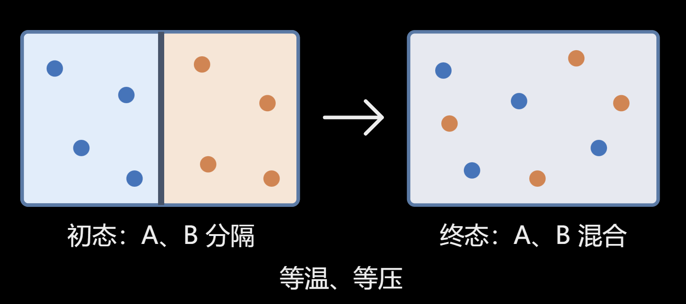
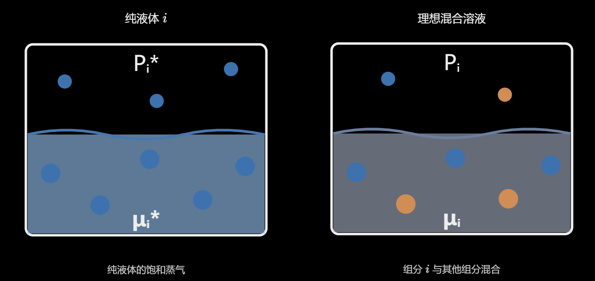

# 第9章 溶液的基本性质

## 第一节 理想气体混合物

$$
\mu=\mu^\circ+RT\ln P
$$

### 1.1 分压定律

理想气体混合物，第 $i$ 个组分分压：

$$
P_i=\frac{n_iRT}{V}
$$

$$
\boxed{P=\sum_iP_i=\sum_i\frac{n_iRT}{V}=\frac{nRT}{V}}
$$

定义第 $i$ 个组分的**摩尔分数**：

$$
\tau_i=\frac{n_i}{\sum_{i=1}^{c}n_i}
$$

$\sum_{i=1}\tau_i=1$, 因此：

$$
P_i=\tau_i P
$$

- 分体积定律违背量子力学，气体波函数的边界为整个容器

$$
V_m=-T\left(\frac{\partial S_m}{\partial P}\right)_{T,n}
$$

- 违背气体体积的热力学意义，熵无法分出体积计算

---

### 1.2 理想气体混合物化学势

$$
\begin{aligned}
\left(\frac{\partial \mu_i}{\partial P_i}\right)_{T,n}
&=
\left(\frac{\partial \mu_i}{\partial P}\right)_{T,n}
\cdot
\left(\frac{\partial P}{\partial P_i}\right)_{T,n}\\
&=
\frac{1}{\tau_i}
\left(\frac{\partial V}{\partial n_i}\right)_{P,T,n_{j\ne i}}\\
&=
\frac{RT}{P\tau_i}
=
\frac{RT}{P_i}
\end{aligned}
$$

其中：

$$
V=\frac{nRT}{P}=\sum_i n_i\frac{RT}{P}
$$

因此：

$$
\begin{aligned}
\int_{\mu_i^\circ}^{\mu_i}d\mu_i
&=\int_{P_i^\circ}^{P_i}\frac{RT}{P_i}\,dP_i\\
\Rightarrow\quad
\mu_i&=\mu_i^\circ+RT\ln\frac{P_i}{P_i^\circ}
\end{aligned}
$$

选择$\mathrm{1 bar}$ 作为标准态：

$$
\mu_i=\mu_i^\circ+RTlnP_i
$$

可见化学势仅与自身分压有关（源于理想气体分子间无相互作用）

---

### 1.3 理想气体混合物的吉布斯自由能

- $T、P$ 恒定，$P=P_A+P_B$，$n_A+n_B$ 恒定

$$
dG=\sum_{i=1}^{c}\mu_i\,dn_i
$$

其中：

$$
dn_i=\frac{n_i}{V_0}\,dV
$$

代入：

$$
dG=\sum_{i=1}^{c}\mu_i\frac{n_i}{V_0}\,dV
$$

理想气体混合物的吉布斯自由能：

$$
\begin{aligned}
G
&=\int_0^{V_0}\sum_{i=1}^{c}\mu_i\frac{n_i}{V_0}\,dV\\
&=\sum_{i=1}^{c}\mu_i\frac{n_i}{V_0}\cdot V_0\\
&=\sum_{i=1}^{c}n_i\mu_i
\end{aligned}
$$

---

### 1.4 混合吉布斯自由能

{: .center width="320"}

**初态**：

$$
T_A=T_B=T
$$

$$
P_A^{(\mathrm{初})}=P_B^{(\mathrm{初})}=P
$$

**终态**：

$$
P=P_A+P_B
$$

$P_A$、$P_B$ 为混合后的**分压**

$$
\begin{aligned}
\Delta_{\mathrm{混}}G
&=G_{\mathrm{终态}}-G_{\mathrm{初态}}\\
&=\sum_i n_i\mu_i-\sum_i n_i\mu_{i(\mathrm{初})}
\end{aligned}
$$

初态各气体的压强均为 $P$：

$$
\mu_{i(\mathrm{初})}=\mu_i^\circ+RT\ln\frac{P}{P^\circ}
$$

代入：

$$
\begin{aligned}
\Delta_{\mathrm{混}}G
&=\sum_i n_i\left(\mu_i-\mu_{i(\mathrm{初})}\right)\\
&=\sum_i n_i RT\ln\frac{P_i}{P}\\
&=\sum_i n_i RT\ln\tau_i
\end{aligned}
$$

$$
\boxed{
\Delta_{\mathrm{混}}G=RT\sum_i n_i\ln\tau_i<0
}
$$

为**自发**过程。

$\Delta_{\mathrm{混}}G$为**状态函数**，始态为参考态

---

### 1.5 其他混合量

!!!WARNING
    此为摩尔数可变过程，不可用两个热容进行状态函数的计算。

$$
\Delta_{混}S=-\left[\frac{\partial(\Delta_{混}G)}{\partial T}\right]_{P,n}
=-\sum_i n_iR\ln\tau_i>0
$$

混合不可逆自发的唯一原因是**系统熵增加**

$$
\Delta_{\mathrm{混}}V
=\left(\frac{\partial \Delta_{\mathrm{混}}G}{\partial P}\right)_{n,T}
=0
$$

$$
\Delta_{混}H=\Delta_{混}G+T\Delta_{混}S\equiv0
$$

$$
\Delta_{混}U=\Delta_{混}(H-PV)=-\Delta_{混}(nRT)\equiv0
$$

---

## 第二节 理想溶液

### 2.1 模型

**理想溶液混合的特征：**

$$
\Delta_{\mathrm{混}}U=0
$$

$$
\Delta_{\mathrm{混}}V=0
$$

因此：

$$
\boxed{\Delta_{\mathrm{混}}H=0}
$$

**理想溶液模型的前提：**

1. 分子间相互作用能相同：

   $$
   \varepsilon_{A-A}=\varepsilon_{A-B}=\varepsilon_{B-B}
   $$

2. A、B 分子的大小和形状近似相同。

!!!EXAMPLE
    - $^{13}\mathrm{C}$ 苯 + 苯
    
    - 氘代苯（$\mathrm{C_6D_6}$）+ 苯（$\mathrm{C_6H_6}$）

---

### 2.2 混合熵

在 $T$、$P$ 不变的条件下，考虑理想溶液的混合过程。

混合前后分子的内部状态不变，只有**分布熵**发生改变：

$$
\Delta_{\mathrm{混}}S
=\Delta S_{\mathrm{分布}}
$$

$$
\Delta_{\mathrm{混}}S=S_{\mathrm{混合}}-S_{\mathrm{初态}}
$$

**以 $\mathrm{HDO/H_2O}$ 混合为例：**

初态：两种液体被隔板分开。

$$
N_{\mathrm{左}}=N_{\mathrm{HDO}}
$$

$$
N_{\mathrm{右}}=N_{\mathrm{H_2O}}
$$

满足：

$$
T_{\mathrm{左}}=T_{\mathrm{右}}
$$

$$
V=V_{\mathrm{左}}+V_{\mathrm{右}}
$$

移除隔板后，总分子数为：

$$
N'=N_{\mathrm{左}}+N_{\mathrm{右}}
=N_{\mathrm{HDO}}+N_{\mathrm{H_2O}}
$$

**（1）初态的状态数**

$$
W_{\mathrm{初态}}
=\frac{N_{\mathrm{左}}!}{N_{\mathrm{HDO}}!}
\cdot\frac{N_{\mathrm{右}}!}{N_{\mathrm{H_2O}}!}
=1
$$

**（2）混合后的状态数**

$$
W_{\mathrm{混合}}
=\binom{N_{H_2O}}{N'}
=\frac{N'!}{N_{\mathrm{HDO}}!\,N_{\mathrm{H_2O}}!}
$$

因此：

$$
\begin{aligned}
\Delta_{\mathrm{mix}}S
&=k_{\mathrm B}\ln W_{\mathrm{混合}}
-k_{\mathrm B}\ln W_{\mathrm{初态}}\\
&=k_{\mathrm B}\ln W_{\mathrm{混合}}-0\\
&=\boxed{k_{\mathrm B}\ln\frac{N'!}{N_{\mathrm{HDO}}!\,N_{\mathrm{H_2O}}!}}
\end{aligned}
$$

**（3）斯特林近似展开**

$$
\ln N!\approx N\ln N-N
$$

$$
\begin{aligned}
\Delta_{\mathrm{mix}}S
&=k_{\mathrm B}\ln\frac{N!}{N_{\mathrm{HDO}}!\,N_{\mathrm{H_2O}}!}\\[6pt]
&=k_{\mathrm B}\left[
N\ln N-N
-(N_{\mathrm{HDO}}\ln N_{\mathrm{HDO}}-N_{\mathrm{HDO}})
-(N_{\mathrm{H_2O}}\ln N_{\mathrm{H_2O}}-N_{\mathrm{H_2O}})
\right]\\[6pt]
&=k_{\mathrm B}\left(
N\ln N
-N_{\mathrm{HDO}}\ln N_{\mathrm{HDO}}
-N_{\mathrm{H_2O}}\ln N_{\mathrm{H_2O}}
\right)\\[6pt]
&=\sum_i k_{\mathrm B}N_i\ln\frac{N}{N_i}\\[6pt]
&=\sum_i n_iR\ln\frac{1}{\chi_i}
\end{aligned}
$$

其中：

$$
N=\sum_i N_i
$$

令 $\chi_i$ 为组分 $i$ 的摩尔分数：

$$
\chi_i=\frac{n_i}{\sum_i n_i}
=\frac{N_i}{\sum_i N_i}
$$

因此：

$$
\boxed{
\Delta_{\mathrm{混}}S
=-R\sum_i n_i\ln\chi_i>0
}
$$

$$
\boxed{
\Delta_{\mathrm{混}}G
=-T\Delta_{\mathrm{混}}S
=\sum_i n_iRT\ln\chi_i<0
}
$$

---

### 2.3 理想溶液中各组分的化学势

混合后溶液的吉布斯自由能：

$$
G_{\mathrm{溶液}}=G_{\mathrm{纯}}+\Delta_{\mathrm{混}}G
$$

$$
G_{\mathrm{纯}}=\sum_i n_i\mu_i^*
$$

其中$\mu_i^*$ 为**纯液体化学势**

$$
\Delta_{\mathrm{混}}G=RT\sum_i n_i\ln\chi_i
$$

$$
G_{\mathrm{溶液}}
=\sum_i n_i\mu_i^*+RT\sum_i n_i\ln\chi_i
$$

根据化学势的定义：

$$
\mu_i=\left(\frac{\partial G_{\mathrm{溶液}}}{\partial n_i}\right)_{T,P,n_{j\ne i}}=\mu_i^*+RT\ln\chi_i
$$

**理想溶液中组分 $i$ 的化学势**为：

$$
\boxed{\mu_i=\mu_i^*+RT\ln\chi_i}
$$

---

### 2.4 理想溶液化学势的测量

{: .center width="320"}

**利用气液平衡测定化学势：**

$$
A(\mathrm{液})\rightleftharpoons A(\mathrm{气})
$$

$P_i$ 为组分 $i$ 在气相中的分压。

纯液体组分 $i$（纯态气液平衡）：

$$
\mu_i^*=\mu_i^\circ+RT\ln P_i^*
$$

$P_i^*$ 为纯组分 $i$ 的饱和蒸气压

$$
\begin{aligned}
\mu_i(\mathrm{溶液})
&=\mu_i^*+RT\ln\chi_i\\
&=\mu_i^\circ+RT\ln P_i^*+RT\ln\chi_i
\end{aligned}
$$

理想溶液气液平衡：

$$
\mu_i(\mathrm{溶液})=\mu_i(\mathrm{气})
=\mu_i^\circ+RT\ln P_i
$$

$$
\mu_i^\circ+RT\ln P_i
=\mu_i^\circ+RT\ln P_i^*+RT\ln\chi_i
$$

$$
\ln P_i=\ln P_i^*+\ln\chi_i
$$

**拉乌尔定律**：

$$
\boxed{P_i=\chi_i P_i^*}
$$

---

## 第三节 混合物广度性质

### 3.1 偏摩尔广度性质

$T$、$P$ 恒定，考虑广度性质 $X$。现有 $c$ 个组分，共 $c+2$ 个变量。

$$
X=f(T,P,n_1,\cdots,n_c)
$$

$$
dX=\sum_{i=1}^{c}\left(\frac{\partial X}{\partial n_i}\right)_{T,P,n_{j\ne i}}dn_i
$$

定义组分 $i$ 的**偏摩尔量**：

$$
\boxed{
{}^{m}X_i=\left(\frac{\partial X}{\partial n_i}\right)_{T,P,n_{j\ne i}}
}
$$

!!!EXAMPLE
    化学势与偏摩尔吉布斯自由能：

    $$
    \mu_i={}^{m}G_i
    $$

    化学势还可表示为：

    $$
    \mu_i=\left(\frac{\partial U}{\partial n_i}\right)_{S,V,n_{j\ne i}}\ne {}^{m}U_i
    $$

    $$
    {}^{m}U_i=\left(\frac{\partial U}{\partial n_i}\right)_{T,P,n_{j\ne i}}
    $$

---

### 3.2 求混合物的广度性质 $X$

$$
\begin{aligned}
X_{\mathrm{混合物}}
&=\int_V\sum_{i=1}^{c}{}^{m}X_i[i]\,dV\\
&=\sum_{i=1}^{c}n_i{}^{m}X_i
\end{aligned}
$$

其中 $[i]$ 表示组分 $i$ 的物质的量浓度。

即混合物的广度性质等于各组分物质的量与其偏摩尔性质乘积之和（加和性）

---

### 3.3 Gibbs-Duhem 方程

**$T$、$P$ 恒定**：

$$
dX_{\mathrm{混合物}}=\sum_{i=1}^{c}{}^{m}X_i\,dn_i\tag{1}
$$

另一方面，由：

$$
X_{\mathrm{混合物}}=\sum_{i=1}^{c}n_i{}^{m}X_i
$$

两边微分：

$$
dX_{\mathrm{混合物}}
=\sum_{i=1}^{c}n_i\,d({}^{m}X_i)
+\sum_{i=1}^{c}{}^{m}X_i\,dn_i\tag{2}
$$

对比$\mathrm{(1)(2)}$得到**Gibbs-Duhem 方程**：

$$
\boxed{
\sum_{i=1}^{c}n_i\,d{}^{m}X_i=0
}
$$

特别地，对于 $G$：

$$
{}^{m}G_i=\mu_i
$$

$$
\boxed{
\sum_{i=1}^{c}n_i\,d\mu_i=0
\qquad (T,P\text{ 恒定})
}
$$

!!!NOTE
    $$
    \chi_1d\mu_1+\chi_2d\mu_2=0
    $$

    一个组分的化学势随浓度改变而增大，则二元均相混合物中另一组分的化学势一定减小。更一般的，对于一个由 $c$ 个组分组成的混合物，在恒温恒压下，只有 \(c-1\) 个化学势可以独立变化。由组成改变引起的各组分化学势变化，对 \(dG\) 的加权贡献之和为零。

!!! EXAMPLE
    设理想溶液中 $n_A=2\ \mathrm{mol}$，$n_B=1\ \mathrm{mol}$，$T=300\ \mathrm K$。

    $$
    \chi_A=\frac23,\qquad \chi_B=\frac13
    $$

    加入少量 A，使 $d\chi_A=0.001$，则 $d\chi_B=-0.001$。

    由 $d\mu_i=RT\frac{d\chi_i}{\chi_i}$：

    $$
    \begin{aligned}
    d\mu_A&=RT\frac{0.001}{2/3}\approx+3.74\ \mathrm{J/mol}\\
    d\mu_B&=RT\frac{-0.001}{1/3}\approx-7.48\ \mathrm{J/mol}
    \end{aligned}
    $$

    验证 GD 方程：

    $$
    \boxed{n_Ad\mu_A+n_Bd\mu_B
    \approx2(3.74)-7.48=0}
    $$

吉布斯-杜安方程的三个特点：

- 方程的任何形式都必须在**定温定压**条件才可使用。

- 方程只适用于均相混合物(广度性质针对单个均匀相建立；多相体系需要考虑**各相的化学势及相平衡条件**)。

- 方程既可用于理想混合物,又可用于非理想混合物。

---

## 第4节 实际溶液

### 4.1 非理想溶液的普遍性

- 混合时$\Delta_{\mathrm{混}}G$ 恒小于零，即固态/气态无限溶解，不存在溶解度
  
- 分子间相互作用能相同难满足

- 理想液体-液体混合需要频率匹配
  
- 接触构型匹配使得分子并非均匀分散（水-乙醇纳米簇，水合离子）

---

### 4.2 实际溶液

#### 传统模型

两种非理想性来源：

**1. 正则溶液**

$$
\begin{cases}
\Delta_{\mathrm{mix}}H\ne 0\\[4pt]
\Delta_{\mathrm{mix}}S=\Delta_{\mathrm{mix}}S_{\text{理想}}
\end{cases}
$$

混合焓不为零，但混合熵等于理想溶液的混合熵。

**2. 无热溶液**

$$
\begin{cases}
\Delta_{\mathrm{mix}}H=0\\[4pt]
\Delta_{\mathrm{mix}}S\ne\Delta_{\mathrm{mix}}S_{\text{理想}}
\end{cases}
$$

混合焓为零，但混合熵偏离理想溶液的混合熵。

#### 驱动力

- **分子间相互作用匹配驱动的非理想**：如乙醇-水混合溶液纳米簇（发生组装，非理想混合熵小于0）

- **非理想混合熵驱动的非理想**：
   - 长链烷烃溶于苯，增加大量构象熵；
  
   - 刚性分子如聚乙炔溶解困难；

   - 对于大量放热的溶解（如硝铵），非理想混合熵需很大以平衡放热带来的**环境负熵**

---

### 4.3 实际溶液$\Delta_{\mathrm{混}}G$

$$
G_{\mathrm{溶液}}=G_{\mathrm{纯}}+\Delta_{\mathrm{mix}}G
$$

$$
G_{\mathrm{溶液}}=\sum_i n_i\mu_i
$$

对于非理想溶液：

$$
G_{\mathrm{溶液}}
=\sum_i n_i\mu_i^*
+\sum_i n_iRT\ln\chi_i
+\sum_i n_iRT\ln\gamma_i
$$

组分 $i$ 的化学势为：

$$
\boxed{\mu_i=\mu_i^*+RT\ln \alpha_i}
$$

**活度** 定义：

$$
\boxed{\alpha_i=\gamma_i\chi_i}
$$

- $\chi_i$：组分 $i$ 的**摩尔分数**
  
- $\gamma_i$：组分 $i$ 的活度系数

理想溶液：

$$
\boxed{\gamma_i\equiv 1}
$$

活度系数反应了系统**所有的非理想性**

---

### 4.4 活度系数实验测量

#### 一般情况

气液平衡测定化学势：

$$
A(\mathrm{液})\rightleftharpoons A(\mathrm{气})
$$

非理想溶液的化学势：

$$
\mu_A(\mathrm{液})=\mu_A^*+RT\ln a_A
=\mu_A^*+RT\ln(\gamma_A\chi_A)
$$

气相视为理想气体：

$$
\mu_A(\mathrm{气})=\mu_A^\circ+RT\ln\frac{P_A}{P^\circ}=\mu_A^\circ+RT\ln\frac{P_A^*}{P^\circ}+RT\ln\frac{P_A}{P^\circ}
$$

气液平衡条件：

$$
\begin{aligned}
\mu_A^*+RT\ln a_A
&=\mu_A^\circ+RT\ln\frac{P_A}{P^\circ}\\
\mu_A^\circ+RT\ln\frac{P_A^*}{P^\circ}+RT\ln a_A
&=\mu_A^\circ+RT\ln\frac{P_A}{P^\circ}
\end{aligned}
$$

$$
\ln(a_AP_A^*)=\ln P_A
$$

$$
\boxed{a_A=\frac{P_A}{P_A^*}}
$$

$$
\boxed{\gamma_A=\frac{P_A}{P_A^*\chi_A}}
$$

#### 目标不挥发

Gibbs-Duhem 方程：

$$
\sum_i n_i\,d\mu_i=0
$$

$$
\mu_i=\mu_i^*+RT\ln\chi_i+RT\ln\gamma_i
$$

代入得：

$$
\underbrace{\sum_i n_i\,d\mu_i^*}_{=0}
+\underbrace{\sum_i n_i\,d(RT\ln\chi_i)}_{=0}
+\sum_i n_i\,d(RT\ln\gamma_i)=0
$$

在恒温恒压条件下：

$$
\boxed{
\sum_i n_i\,d\ln\gamma_i=0
}
$$

---

### 4.5 混合广度性质与活度系数

$$
G_{\mathrm{混合物}}=G_{\mathrm{纯}}+\Delta_{\mathrm{混}}G
$$

$$
G_{\mathrm{纯}}=\sum_i n_i\mu_i^*
$$

**混合吉布斯自由能：**

$$
\boxed{
\Delta_{\mathrm{混}}G
=\sum_i n_iRT\ln\chi_i
+\sum_i n_iRT\ln\gamma_i
}
$$

**混合熵：**

$$
\begin{aligned}
\Delta_{\mathrm{混}}S
&=-\left(\frac{\partial\Delta_{\mathrm{混}}G}{\partial T}\right)_{P,n}\\[6pt]
&=\underbrace{-\sum_i n_iR\ln\chi_i}_{\text{理想混合熵}}
-\sum_i n_iR\ln\gamma_i-\sum_i n_iRT
\left(\frac{\partial\ln\gamma_i}{\partial T}\right)_{P,n}
\end{aligned}
$$

**混合焓：**

$$
\Delta_{\mathrm{混}}H
=\Delta_{\mathrm{混}}G+T\Delta_{\mathrm{混}}S
$$

$$
\boxed{
\Delta_{\mathrm{混}}H
=-\sum_i n_iRT^2
\left(\frac{\partial\ln\gamma_i}{\partial T}\right)_{P,n}
}
$$

**混合体积：**

$$
\begin{aligned}
\Delta_{\mathrm{混}}V
&=\left(\frac{\partial\Delta_{\mathrm{混}}G}{\partial P}\right)_{T,n}\\[6pt]
&=\sum_i n_iRT
\left(\frac{\partial\ln\gamma_i}{\partial P}\right)_{T,n}
\end{aligned}
$$

**混合内能：**

$$
\Delta_{\mathrm{混}}U
=\Delta_{\mathrm{混}}H-P\Delta_{\mathrm{混}}V
$$

$$
\begin{aligned}
\Delta_{\mathrm{混}}U
&=-\left[
\sum_i n_iRT^2
\left(\frac{\partial\ln\gamma_i}{\partial T}\right)_{P,n}
+\sum_i n_iRTP
\left(\frac{\partial\ln\gamma_i}{\partial P}\right)_{T,n}
\right]\\[8pt]
&=-\sum_i n_iRT
\left[
\left(\frac{\partial\ln\gamma_i}{\partial\ln T}\right)_{P,n}
+\left(\frac{\partial\ln\gamma_i}{\partial\ln P}\right)_{T,n}
\right]
\end{aligned}
$$

---

### 4.6 混合偏摩尔量

$$
\Delta_{\mathrm{混}}H
=\sum_i n_i\left({}^{m}H_i-H_{m,i}\right)
=\sum_i n_i\Delta_{\mathrm{混}}H_i
$$

$$
\boxed{
\Delta_{\mathrm{混}}H_i
=-RT^2\left(\frac{\partial\ln\gamma_i}{\partial T}\right)_{P,n}
}
$$

